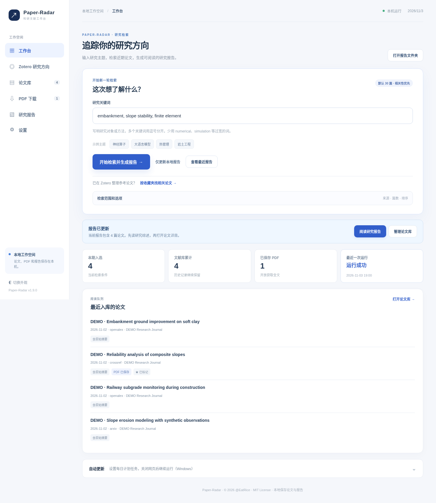

# Paper-Radar

**把最新文献整理成一份可以继续阅读和归档的研究简报。**

Paper-Radar 提供本地科研文献追踪工作台与独立的多账号公网科研门户。桌面版可在个人电脑上完整使用，本次新增的公网版为面向互联网开放的受控功能集。输入研究关键词，或选择本机 Zotero 收藏夹作为研究参考，可以检索最近的论文、管理阅读状态、下载开放获取 PDF，并导出 Word、Markdown 与 CSV。界面通过本地浏览器访问，检索记录和报告保存在电脑上。

- **正式仓库：** https://github.com/QiQiWan/Paper-Radar
- **版本：** 1.21.0
- **作者与版权：** © 2026 @EatRice，代码按照 [MIT License](LICENSE) 发布（发布者须确认完整代码的授权资格）。
- **环境：** Python 3.10+，Windows 优先；macOS/Linux 可运行基础检索，Windows 后台计划任务仅在 Windows 上可用。



## v1.21.0：断网检索恢复、双栏 PDF 精读与实验比较矩阵

- **断网检索不再无限等待：** 桌面版已启用独立检索来源子进程和真实挂钟时限，默认每组查询最多 10 秒，一次检索最多 75 秒；超时结束进程、跳过故障来源、继续其余已启用来源。失败时状态归档为失败，并保留按来源的耗时/超时诊断；在“设置 → 来源故障与超时控制”调整阈值。取消、Agent 截止时间会立即向上报告。公网 arXiv 单独沿用受控、较短网络重试和 Worker 队列。
- **全文与证据并排核查：** 公网版按账号与研究主题隔离地在论文库内加载 PDF（支持分页字节范围），与经 PDF 指纹核验的实验指标、原文引文和页码并排显示；桌面端的“全文证据”也加入 PDF 左侧预览。浏览器不支持内置 PDF 阅读时可在新标签页打开。
- **实验比较矩阵：** 研究报告页根据已保存的 Synthesis 快照展示按数据集、评价指标与条件筛选的多论文对比矩阵，保留原始数值、基线、证据等级和页码；可以跳转到当前账户对应的 PDF 页。存在基线冲突、单位或数据划分不确定性时明确提示人工复核，不自动给论文排名。
- **浏览器修复：** 已修复手机端较宽的比较表撑开工作台的问题，表格在局部横向滚动。多账号 PDF 访问与旧版本失效均经 HTTP 测试。

详情：[设计与风险审查](docs/DESIGN_V1.21.0.md)、[阅读与比较操作](docs/PORTAL_GUIDE_V1.21.0.md)、[升级说明](docs/UPDATING_V1.21.0.md)、[测试报告](docs/TEST_RESULTS_V1.21.0.md)。Windows 文献网站真实故障、完整浏览器 PDF 插件和公网 HTTPS 部署仍须在目标设备验证。

## v1.20.0：五入口科研工作台与论文阅读管理

公网工作台已调整为**工作台、论文库、任务中心、研究报告、我的账号**五个独立业务入口，手机使用固定底部导航。工作台显示当前研究主题统计、最近任务和最近文献；论文库支持题名/摘要/DOI 搜索、星标、阅读状态与相关性反馈，并在服务端按账号、研究主题保存。历史任务及报告继续使用 v1.19.1 的独立 Worker 和快照。

桌面版新增独立“任务中心”入口，Zotero 与 PDF 下载仍可通过扩展工具使用。公网工作区自动迁移至 v4，保留原有文献、报告与实验数据；升级前须停 Web/Worker、备份数据。详细说明：[v1.20.0 功能与 UX 审查](docs/DESIGN_V1.20.0.md)、[五入口操作手册](docs/PORTAL_GUIDE_V1.20.0.md)、[升级指南](docs/UPDATING_V1.20.0.md)、[测试报告](docs/TEST_RESULTS_V1.20.0.md)。**仍需在目标公网服务器验证 HTTPS 与 Windows 自动更新，当前源码包未使用生产签名。**

## v1.19.1：公网体验集中修复与可追溯任务、报告

- **任务可复盘：** 独立 Worker 在发现论文、PDF 下载、全文解析、证据核验及报告生成时写入结构化任务阶段事件。公网工作台支持查看最近任务详情、排队/执行/失败状态及异常原因；已完成阶段默认可折叠，失败时可展开。
- **研究报告可重复阅读：** 报告由科研 Worker 在任务执行时存为账号独立的 SQLite 快照。公网页面可按照当前研究主题查看历史报告、在线阅读表格与引文、下载 Markdown；反复打开报告不会再触发 AI 分析。
- **操作可访问性：** 补齐桌面与公网静态表单可访问名称，增强辅助文字对比度、焦点提示和窄屏布局；网页原文以安全 DOM API 渲染，避免把报告内容解释为可执行 HTML。
- **兼容与升级：** 保留原有 Web/Worker、Zotero、PDF 与下载接口；公网账号库增加迁移 v6，用户工作区增加迁移 v3，升级前必须停止服务并备份账号数据库和所有用户工作区。详细变更和操作参见 [v1.19.1 用户体验与验收](docs/UX_FIX_V1.19.1.md)、[升级指南](docs/UPDATING_V1.19.1.md)。

## v1.19.0：独立科研 Worker 与真实论文评估

公网 Web 默认只负责 HTTP 和持久化任务队列，科研任务由独立 `paper_radar.portal_worker` 进程运行。新增租约、心跳、过期恢复、受限任务子进程和多 Worker 防重。Linux 使用 `start_public_worker_macos_linux.sh`，Windows 使用 `start_public_worker_windows.bat`；公网端口仍由原 Web 启动脚本自由指定。开发调试可显式设置 `serve --embedded-workers`。

新增 [独立 Worker 部署和可靠性验收](docs/WORKER_DEPLOYMENT_V1.19.0.md) 及 [真实论文评估方法](docs/REAL_PAPER_EVALUATION_V1.19.0.md)。真实 FNO、U-FNO、PINO 的论文身份、原文页码和人工核对表格已经整理为可复现的种子集；缺少本地 PDF 和模型预测时只报告未测量状态，禁止宣称全文解析与抽取准确率已验收。

## v1.18.0：公网账号级全文研究工作流与安全验收

公网版新增“检索 → PDF 获取/上传 → 独立全文解析 → 可选实验信息提取 → 原文证据核验 → 跨论文 SynthesisAgent 比较”完整任务链。检索和科研分析可以按任务类型单独提交，统一存储为 SQLite 持久化任务；支持账号独立文件存储、PDF 版本失效、少量开放 PDF 自动下载、手动上传与单篇分析。云模型调用由用户显式授权且需要服务器单独配置，默认不调用云模型。

本轮新增单实例锁、访问控制校验、资源限制、服务安全只读验收脚本和账号数据一致性备份工具。登录、论文、PDF 和证据均按账号隔离。**仍属受控公网版**，真实 HTTPS/Nginx、高并发、恶意 PDF 及 Windows 自动更新尚需目标环境验收。首次升级前请停机备份；账号数据库迁移至 v4，工作区迁移至 v2。详细说明见 [完整设计与风险边界](docs/DESIGN_V1.18.0.md)、[公网部署与使用手册](docs/PUBLIC_DEPLOYMENT_V1.18.0.md)及 [发布说明](docs/RELEASE_NOTES_V1.18.0.md)。

## v1.17.0：公网持久化任务、账号隔离和科研证据质量诊断

公网检索任务现保存于 SQLite，可在服务重启后恢复，支持排队位置、最近任务、取消及管理员任务统计；每账号同一时刻仅有一个活动任务，默认双 worker，并修复滚动 24 小时检索配额的窗口错误。公网论文库可以分页加载更多。Nginx 真实客户端 IP 可以在明确受信配置下识别，默认不会信任任何客户端转发头。

跨论文比较补充未核验证据、字段缺失、重复、基线冲突、相同实验条件下不同数值和单位表达不一致的提示。报告仍只给出人工比较候选，不自动计算跨论文指标提升。**本版保持16个Agent及桌面版入口不变。**

参考：[v1.17.0 架构设计与已完成改动](docs/DESIGN_V1.17.0.md)、[公网部署和任务操作](docs/PUBLIC_DEPLOYMENT_V1.17.0.md)、[版本发布说明](docs/RELEASE_NOTES_V1.17.0.md)。公网使用前需停机备份 `PAPERRADAR_PORTAL_DATA`，首次启动迁移账号数据库至 v3。生产站点仍需要 HTTPS、流量治理和风险监测。

## v1.16.0：安全发布、科研综合比较和公网账号门户

**桌面科研综合分析：** 新增三阶段 SynthesisAgent 工作流，对当前研究主题内已核验的实验记录进行跨论文归纳，保留原始页码、引文、数据集和实验条件。仅把完整条件一致的实验列为“待人工核查”比较候选。入口在“研究报告 → 跨论文比较”，或通过 Agent 图查看 `python -m paper_radar.agents synthesis-graph`。

**安全签名更新：** v1.16.0 开始，后续自动安装要求 GitHub 正式 Release 同时提供 `Paper-Radar_vX.Y.Z_Source.zip`、`Paper-Radar_vX.Y.Z_release.json` 和 `Paper-Radar_vX.Y.Z_release.sig` 三个附件，使用固定在程序内的 Ed25519 公钥验证签名。首度从 v1.15.0 升级到 v1.16.0，建议人工校验并手动覆盖代码；发布者的私钥绝不能上传到仓库或部署服务器。[发布签名操作](docs/PUBLISH_GITHUB.md) · [数据库迁移与回滚](docs/MIGRATIONS_V1.16.0.md)。

**公网独立入口：** 新增可自助注册的账户管理与在线主题/论文库，配备有界 arXiv 检索、实验证据 CSV 导入和跨论文比较。公网入口不能访问桌面本地文件、Zotero、模型密钥和更新器。公网和桌面数据默认分离。[部署说明](docs/PUBLIC_DEPLOYMENT_V1.16.0.md)；启动脚本端口示例：

```bash
# Linux: 先将 PAPERRADAR_PUBLIC_ORIGIN 配为已启用 HTTPS 的域名
PAPERRADAR_PUBLIC_ORIGIN=https://papers.example.com sh start_public_macos_linux.sh 8899
# Windows cmd: set PAPERRADAR_PUBLIC_ORIGIN=https://papers.example.com
# 然后 start_public_windows.bat 8899
```

更换后端端口时可使用 `python tools/render_public_nginx.py --domain papers.example.com --port 9009 --out ./paperradar-9009.conf` 生成配置。请通过 Nginx HTTPS 反向代理 `127.0.0.1:8899`，**不要直接向公网开放本机端口或使用本地 desktop Web 服务**。面向大规模公众前还需要邮件验证及反机器人等运维配套。详见 [v1.16.0 设计与审查](docs/DESIGN_V1.16.0.md)。

## v1.15.0：启动前自动更新与失败回滚

现在通过 `start_windows.bat` 或 `sh start_macos_linux.sh` 正常启动时，会先使用较短网络超时检查固定仓库 `QiQiWan/Paper-Radar` 的最新正式 GitHub Release。若出现更高版本且发布者上传了命名规范的源码 ZIP，GitHub API 提供了 SHA-256 摘要，程序会**先下载和校验、保留程序与数据库快照，再安装并启动新版本**。断网、校验失败、磁盘不足或找不到更新包时，跳过更新并启动现有程序。安装后启动失败会自动回滚。

开启/关闭入口：`设置 → 软件更新检查 → 启动前自动下载并安装新版本`。紧急跳过检查可运行 `start_windows.bat --no-update` 或 `sh start_macos_linux.sh --no-update`。升级记录保存于 `.paper_radar_updates/status.json`，更多注意事项见 [安全升级手册](docs/UPDATING.md)。

**首次迁移需要手工操作：** v1.14.0 的启动脚本没有自动安装能力，所以从旧版安装 v1.15.0 时需要手动替换源码与启动脚本。自动更新能力将从此后的兼容正式版本开始生效。`data/`、`settings.json`、`downloads/`、`reports/` 应始终保留。更新只信任指定 GitHub 仓库的正式 Release；未经其发布的本地 ZIP 不会被自动发现。

## v1.14.0：实验指标分析与原文核验

在原九 Agent 工作流之外新增一条**手动启动**的四阶段科研分析 Agent 流程：全文准备、AI 实验信息候选提取、逐字证据核验和结构化成果入库。论文库“全文证据”可以提取数据集、指标、原文数值、对照基线与 PDF 页码；研究报告可导出当前主题的 `实验结果证据索引.csv`。每次最多向用户选择的模型服务商发送一篇论文的16个有界正文片段，提交前有明确确认提示，常规检索不会自动发起该调用。

**证据与限制：** 只有同一原文片段能支持的字段才会保存；PDF 在模型调用过程中被替换时拒绝保存；复杂表格、OCR 和跨论文实验可比性仍需人工核对。开发者可执行 `python -m paper_radar.agents research-graph` 查看独立分析工作流。详细设计见 [v1.14.0 科研 Agent 方案](docs/AGENT_ARCHITECTURE_V1.14.0.md)。

## v1.13.1：Agent 执行控制与成本可观测性

在九 Agent 架构基础上，增加可声明的读取/写入/模型调用能力、协作式执行预算和有限的错误重试。读取型文献发现遇到暂时性网络故障可自动再试一次；写库、文件导出与可能产生 API 费用的 Agent 禁止盲目重试。

`设置 → Agent 工作流` 可查看阶段尝试次数、耗时和已上报 Token。`设置 → 中文速览 → 模型费用估算` 可选填写当前模型每百万输入/输出 Token 的美元单价；不填写时不显示估算费用。费用仅供核算参考，实际计费须查看模型供应商控制台。开发者可运行 `python -m paper_radar.agents doctor` 检查模块注册，不需要网络或 API Key。

详情见 [v1.13.1 执行治理设计](docs/AGENT_RUNTIME_V1.13.1.md) 与 [CHANGELOG](CHANGELOG.md)。

## v1.13.0：Agent 模块化

每日检索与报告主流程现由**九个独立 Agent**负责，包含研究画像、来源发现、质量筛选、推荐排序、论文入库、中文速览、PDF 下载、报告选文与报告生成。Agent 之间通过显式契约传递中间数据；可选大模型和下载阶段发生错误时，能够保留其他成功阶段的结果并提示“部分完成”。

在“设置 → Agent 工作流”查看每个模块的职责、最近状态与耗时。维护者可使用 `python -m paper_radar.agents list` 查看完整定义，或执行 `python -m paper_radar.agents graph` 获取依赖图。本次没有改变基本检索、Zotero、全文证据与报告操作方式。详细说明见 [v1.13.0 Agent 设计与独立研发](docs/AGENT_ARCHITECTURE_V1.13.0.md)。

## 可以做什么

**v1.12.0：** 新增本地 PDF 按页全文索引、原文片段检索、用户确认后的 AI 证据阅读卡片和可引用页码的 Word/Markdown 报告；增加人工标注模板及离线推荐质量评价。PDF 更新后旧证据自动失效。全部新功能按需使用，普通检索无需模型 Key。详情见 [v1.12.0 完整设计](docs/DESIGN_V1.12.0.md)。

**v1.11.0：** 在 v1.10 研究主题与官方版本更新提醒基础上，进一步实现每个主题独立的论文相关度、星标、阅读状态与反馈；增加按顺序追踪全部研究主题、可查询的本地运行历史，以及**默认关闭**的 OpenAlex 语义发现和大模型“标题摘要证据”推荐排序。普通检索无需模型 Key。模型相关结论以标题/摘要为证据范围，重要学术判断需要查看原文。

**v1.10.0：** 新增多研究主题与独立报告归档、多查询关键词检索、GitHub Release 后台自动更新检查及桌面提示；保留 v1.9.1 的 AI 检索规划、跨来源摘要合并修复和 AI 数值依据检查。多查询按来源设定上限和间隔；关闭自动检查后仍可手动查询正式发布版本。

| 功能 | 当前支持 |
| --- | --- |
| 文献检索 | arXiv、OpenAlex、Crossref；可选 Springer Nature、Elsevier Scopus、ScienceDirect；每来源多关键词查询（查询量可设定） |
| 检索范围 | 默认按相关性选30篇；新版筛除未来、过期或日期不完整题录与仅匹配宽泛词的论文；可在检索高级选项中调整回溯天数、数量、排序 |
| 研究主题 / Zotero | 多主题独立检索配置、报告、星标、阅读状态及相关性反馈；连接 Zotero 本地 API 或只读读取 `zotero.sqlite`，按收藏夹提词、排除已有文献 |
| 论文库 | DOI 去重、主题级相关性推荐、标题摘要搜索、星标、阅读状态、相关/不相关反馈、分类折叠与分页 |
| PDF | 下载开放获取 PDF、批量下载、失败重试；按需建立本地分页索引和原文证据检索 |
| 报告 | Word、Markdown、CSV，含本期研究综述；可附已核验的 PDF 引文页码与 AI 阅读卡片；Markdown 在线预览 |
| 运行监控与更新 | 检索进度、分阶段日志；Windows 每日后台任务（可选择全部主题）；运行历史；自动/手动检查官方 GitHub Release 并提醒更新 |
| 模型 | DeepSeek、豆包、OpenAI API、Claude、通义千问、智谱、硅基流动、Gemini、兼容接口；可选 AI 检索词建议、摘要级中文速览、证据约束推荐排序、模型调用统计 |

**默认启用** arXiv、OpenAlex、Crossref；Springer、Scopus、ScienceDirect 默认关闭。后者需要向出版社申请 API Key 并满足相应接口权限，机构订阅、校园网/VPN 或机构令牌可能影响授权。此软件目前只通过出版社接口取得题录，不提供付费全文自动下载。

## 运行

Windows：安装 [Python 3.10+](https://www.python.org/downloads/)，勾选 **Add Python to PATH**；将仓库下载到固定文件夹，双击 `start_windows.bat`。首次运行会创建 `.venv` 并安装所需依赖；随后浏览器打开本机工作台。

macOS / Linux：

```bash
sh start_macos_linux.sh
```

命令行：

```bash
python main.py --serve   # 打开本地网页工作台
python main.py --once    # 立即检索一次并生成报告
python main.py --cached  # 只用本地论文库更新报告
python main.py --demo    # 生成虚构数据的版式演示
```

在工作台输入英文关键词，例如 `neural operator, operator learning`，保留默认来源，点击 **检索并生成报告**。任务进度和日志会显示在顶部。检索完成后前往 **论文库** 及 **研究报告**。不配置大模型也能检索和生成报告。

**AI 检索词规划（v1.9.1 起）：** 先在设置页配置并保存有权限的模型 API Key；回到工作台，展开“用 AI 规划检索词”，写下研究问题，点击“生成检索词建议”；确认、修改英语检索词后点击“应用至研究关键词”，最后由用户单独点击“开始检索并生成报告”。该规划不会自动保存主题、发起检索或访问 Zotero。AI 仅根据输入的研究描述提出检索词，不能保证文献覆盖完整。v1.10.0 起，各适用来源分别执行多组检索，默认最多采用前8组关键词，可在设置中调整（1—20组）；增加组数可能提升 API 调用量。

## 多研究主题与软件更新（v1.10.0）

在工作台顶部的“研究主题”选择器中可以新建、重命名、切换或删除主题。每个主题保留各自的关键词、来源、检索时间范围、Zotero 收藏夹关联和报告；默认主题依旧写入 `reports/`，新建主题的报告写入 `reports/themes/<主题ID>/`。历史文献数据库及下载的 PDF 共用；删除主题只移除配置记录，不会自动删除历史报告和论文。v1.11.0 可以在“每日自动检索”勾选“每日依次追踪全部研究主题”；未勾选时继续追踪当前活动主题。每个主题分别保存阅读状态、星标与相关性反馈，论文元数据、PDF 与下载状态共用。

启动本地网页后，系统默认每24小时后台查询一次 GitHub 仓库的最新**正式 Release**；发现更新会在工作台顶部提醒，点击“查看官方版本”前往官方发布页。可以在“设置 → 软件更新检查”开启/关闭自动检查、修改6—168小时的间隔、随时手动检查。v1.15.0 起，经 SHA-256 校验的兼容正式版本可在正常启动前自动安装；升级前仍建议备份本地数据。Git 标签或 Draft Release 不会触发提示。详细步骤请看 [更新检查与安全升级](docs/UPDATING.md)。

## AI 推荐、语义发现与运行历史（v1.11.0）

用户可在 **设置 → 智能推荐** 开启模型重排序，并将候选篇数设置为 1—30 篇（建议先用 10—15 篇）。请先配置相应服务商的 API Key。工作台的 AI 研究目标作为推荐依据。模型分析只使用候选论文题名与摘要，并需要给出来自原始文本的证据片段；若缺少证据或服务失败则保持既有排序。每次可能产生模型费用；当前没有验证全部服务商的实际费用与调用兼容性。

**OpenAlex 语义发现** 是检索高级选项中的可选来源，默认关闭。该接口支持自然语言研究问题，但可能使用独立的检索额度。建议先完成普通关键词检索，再确认 OpenAlex 官方账户与额度后开启。只接收返回的论文题录，不下载受版权限制的 PDF。

在 **论文库** 顶部选择“当前研究主题”或“所有已收录文献”，对论文点击 **相关 / 不相关**，当前主题的推荐顺序会随之调整。进入 **设置 → 运行记录** 可以检查近期主题执行情况。批量执行时部分主题失败，会显示“部分完成”，成功主题已有的报告不会丢失。

升级前请备份 `data/papers.sqlite3`。旧的星标与阅读进度保存在默认主题；升级前存在的其他研究主题无法自动恢复精确的历史归属，需要按各主题重新执行一次检索。

## 全文证据精读与推荐评估（v1.12.0）

论文库中已经下载 PDF 的卡片提供 **全文证据** 按钮。点击 **解析本地 PDF**，程序在本机按页提取原文并建立索引，**不调用云端模型**。随后可以搜索论文中的技术术语，查看 PDF 原文页码；切换为“当前主题”可检索本课题已索引的论文。

需要方法、实验和局限的 AI 阅读卡片时，点击 **生成 AI 阅读卡片** 并确认费用与上传范围。系统会向配置的模型发送最多12个有界的 PDF 文本片段，严格核对模型所引用的原文。生成的卡片可复制为 Markdown，也可重新导出 Word/Markdown 汇总报告。扫描 PDF、复杂表格和公式仍需人工阅读原文；含引文的模型解释不等于人工学术审查。文件被替换后必须重新建立索引。

**人工评价推荐质量：** 先导出 CSV 标注模板，再人工填写 0—3 级相关性评价，最后运行离线评估：

```bash
python -m paper_radar.evaluation --export-template reports/推荐标注模板.csv --max-per-topic 50
python -m paper_radar.evaluation --labels reports/推荐标注模板.csv --k 10 --out reports/推荐评估.json
```

推荐分数和人工标注有不同含义，评价报告同时说明标注覆盖率。详见 [完整操作指南](docs/USAGE.md) 和 [设计方案](docs/DESIGN_V1.12.0.md)。

## Zotero 与授权来源

Zotero 用户先打开软件，在 **设置 → 高级 → 杂项** 勾选“**允许此计算机上的其他应用程序与 Zotero 通讯**”，再到 Paper-Radar **Zotero 研究方向** 连接收藏夹。也可使用只读 SQLite 方式。参考 [Zotero 图文说明](docs/ZOTERO_QUICKSTART.md)。

Springer Nature、Elsevier 的出版社 API 凭据在 **设置 → 出版社检索授权** 配置，开启相应来源后才发起请求。OpenAlex 的公开额度若不足，可通过环境变量 `OPENALEX_API_KEY` 配置。详情见 [文献来源及访问权限](docs/SOURCES_AND_ACCESS.md)。

## 模型设置与用量

在 **设置 → 中文速览** 选择服务商。推荐先尝试 DeepSeek：打开 [DeepSeek API 平台](https://platform.deepseek.com/)，创建 API Key，保持接口地址 `https://api.deepseek.com`，选择有权限的模型（预置为 `deepseek-flash`），点击“保存并测试连接”。

可选择豆包、OpenAI / ChatGPT API、Claude 等其他平台，模型 ID 和权限应以各平台控制台为准。Paper-Radar 记录本机成功调用的请求数与 Token；**DeepSeek 可尝试查询官方余额**，其他平台提供官方用量页面。中文速览会发送论文标题与摘要；手动触发 AI 检索词规划则会发送研究描述。已缓存的旧模型摘要会按新提示词版本自动失效并在符合限额时重新生成，这可能产生一次额外 API 费用。自动数值校验只能筛查部分明显问题，科研结论仍须回到原论文核实。详情见 [模型 API 配置](docs/API_PROVIDERS.md)。

## 文件位置

| 路径 | 内容 |
| --- | --- |
| `settings.json` | 检索、来源和模型设置（不保存密钥） |
| `data/papers.sqlite3` | 本地文献库、全文分页片段和证据卡片（随数据库一起备份） |
| `data/api_usage.json` | Paper-Radar 本机模型调用统计 |
| `data/run_history.sqlite3` | v1.11.0 运行历史（只含任务摘要） |
| `data/update_check.json` | 最近一次 GitHub Release 检查时间和状态；不含研究数据 |
| `downloads/` | 下载的开放获取 PDF |
| `reports/` | 默认主题的 Word、Markdown、CSV 报告；其他主题分别存放在 `reports/themes/<主题ID>/` |
| `logs/` | 手动任务与后台任务日志 |

个人配置、数据库、下载和日志已列入 `.gitignore` 与源码打包排除规则。凭据默认由操作系统凭据管理器保存。**提交前仍应自行核对 `git status`。**

## 文档

[v1.12.0 设计方案](docs/DESIGN_V1.12.0.md) · [v1.12.0 实施审阅](docs/REVIEW_V1.12.0.md) · [v1.12.0 测试结果](docs/TEST_RESULTS_V1.12.0.md) · [v1.11.0 历史方案](docs/DESIGN_V1.11.0.md) · [v1.11.0 审阅](docs/REVIEW_V1.11.0.md) · [v1.10.0 历史审查](docs/REVIEW_V1.10.0.md) · [更新日志](CHANGELOG.md) · [更新与升级指南](docs/UPDATING.md) · [v1.9.1 历史审查](docs/REVIEW_V1.9.1.md) · [完整操作手册](docs/USAGE.md) · [文献来源与授权](docs/SOURCES_AND_ACCESS.md) · [模型 API](docs/API_PROVIDERS.md) · [报告说明](docs/REPORTS.md) · [v1.9 旧版截图清单](docs/REAL_SCREENSHOTS.md) · [Zotero](docs/ZOTERO_QUICKSTART.md) · [模块架构](docs/ARCHITECTURE.md) · [GitHub 发布](docs/PUBLISH_GITHUB.md) · [公众号教程](docs/PUBLIC_ARTICLE.md)

## 离线复核已生成的题录

程序自带 `tools/offline_review.py`，可读取本地 CSV，按指定基准日期和研究词复核，并重新输出 Word、Markdown。此过程不访问学术网站，也不修改原始数据库。示例命令见 [报告说明](docs/REPORTS.md)。

## 测试与发布

```bash
python -m pip install -r requirements.txt
python -m pip install pytest
python -m pytest -q
python -m compileall -q paper_radar main.py
node --check paper_radar/static/app.js
python tools/package_release.py --out Paper-Radar_Source.zip
```

单元测试使用模拟 API 和 Zotero 数据；真实 API 配额、机构授权、PDF 可用性及 Windows 任务计划程序仍应在使用环境中验证。下载论文的版权和再使用权限遵循原作者及出版社条款。本项目与 Zotero、arXiv、OpenAlex 和出版社无官方隶属关系。
