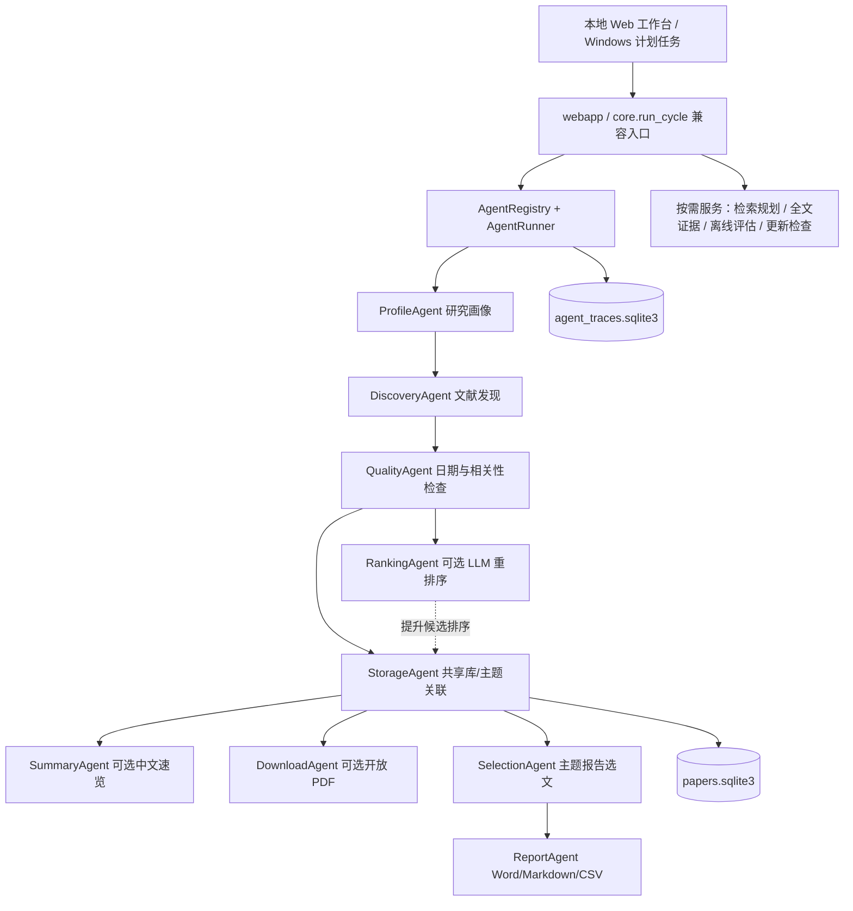

> 更新：v1.13.1 已加入阶段能力声明、有限重试与 Token 统计，见 [运行治理设计](AGENT_RUNTIME_V1.13.1.md)。

# Paper-Radar v1.13.0：Agent 模块化设计与落地报告

**适用版本：1.13.0｜日期：2026-11-04｜性质：已实现架构 + 下一阶段研发计划**

## 一、结论与范围

Paper-Radar 可以拆分为具有独立输入、输出、测试和版本号的专职 Agent。目前已有的来源适配器、Zotero、推荐、PDF 与报告实现具备良好的分工基础，真正影响并行研发的是原 `core.run_cycle()` 集中了全部主流程、模块间没有明确的输出所有权、辅助阶段故障很难单独诊断。

v1.13.0 已将**每日文献追踪主流程**拆为九个实际运行的 Agent，并引入标准契约、依赖图校验、可恢复的非关键故障降级、单独运行记录与本地 UI 状态检查。旧的 `core.run_cycle()` 接口保留；原有 Web UI、Windows 计划任务、多主题批处理、SQLite 论文库以及 Word/Markdown/CSV 报告继续沿用。用户的模型 API Key、Zotero 收藏夹和 PDF 路径不需要迁移。

“Agent”在本文中表示**职责独立且具备声明式接口的科研工作单元**。其中有些 Agent 调用大模型，有些通过普通程序执行数据处理。对于发现、下载、入库、版本检查等确定性任务，限制模型自由选择工具有助于稳定性、可追溯性和授权控制。

## 二、分层架构



`AgentRegistry` 负责注册、唯一性、版本与输入输出所有权校验；`AgentRunner` 只根据声明的依赖执行，不允许模型改变执行图。普通数据对象只存放于本次 Python 运行的 `AgentContext.state`，不会写到运行轨迹数据库。输出报告仍保存在旧版的 `reports/` 或 `reports/themes/<topic_id>/`。

## 三、九个已实现 Agent 的责任清单

| Agent | 独立源码 | 直接输入 | 核心输出 | 故障策略 | 云端模型 |
|---|---|---|---|---|---|
| Profile | `agents/stages/profile.py` | 当前主题/Zotero 配置 | `profile_ranker` | 原有 Zotero 回退 | 无 |
| Discovery | `agents/stages/discovery.py` | 已启用来源、关键词、限额 | `retrieved` | 关键，失败终止 | 无 |
| Quality | `agents/stages/quality.py` | 题录、日期、Zotero 对照 | `curated`,`removed_dates` | 关键，失败终止 | 无 |
| Ranking | `agents/stages/ranking.py` | 候选、目标、配置模型 | `ranked`,`ai_rerank` | 可降级 | 可选 |
| Storage | `agents/stages/storage.py` | 排序候选及主题 ID | `stored`,`new_papers` | 关键，失败终止 | 无 |
| Summary | `agents/stages/summary.py` | 入库记录、模型设置 | 无中间对象，记录生成数量 | 可跳过/降级 | 可选 |
| Download | `agents/stages/download.py` | 入库记录、开放 PDF 地址 | 下载统计 | 可跳过/降级 | 无 |
| Selection | `agents/stages/selection.py` | 主题记录、近期范围及有效全文证据 | `recent`,`new_selected` | 关键，失败终止 | 无 |
| Report | `agents/stages/report.py` | 当前主题选文、有效证据 | `report_files` | 关键，失败终止 | 无 |

**数据约束：** `papers` 存放可复用元数据，`topic_papers` 存放主题级排序与阅读反馈。StorageAgent 是主流程中规范化写入两张表的唯一阶段；SummaryAgent 仅更新模型摘要缓存，DownloadAgent 仅更新 PDF 下载状态。选文与输出阶段不修改原始论文记录。原则上禁止一个 Agent 越权修改别的模块的数据。

**扩展说明：** 现有的检索词规划（`ai_planner.py`）、全文索引及证据卡片（`fulltext.py`）、推荐评估（`evaluation.py`）、更新检查（`updates.py`）仍按用户动作或独立后台任务运行，已收录在 `/api/agents` 的 `on_demand` 清单。本轮没有将它们强制插入每日流程，避免在用户无明确授权时自动发送全文或增加 AI 成本。其进一步的 Agent 标准化属于后续工作。

## 四、契约、依赖与插件机制

**统一契约：** `agents/contracts.py` 包含 `AgentSpec`、`AgentContext`、`AgentResult` 和 `Agent`。每个 Agent 声明 `name`、`version`、`purpose`、`depends_on`、`requires`、`produces`、`kind`、`failure_policy`、`sends_to_cloud` 和 `owner_module`。`AgentRegistry.plan()` 对依赖循环、缺失模块、输入未声明生产者、重复输出所有权进行拒绝。`AgentRunner.run()` 再校验执行时的实际输出字段，阻止缺少必要数据的步骤假装成功。

最小新增 Agent 实例：

```python
from paper_radar.agents import Agent, AgentSpec, AgentResult

def execute(ctx):
    candidates = ctx.state['curated']  # read-only upstream data by convention
    return AgentResult({'candidate_count':len(candidates)},
                       metrics={'count':len(candidates)})

agent = Agent(AgentSpec(
    name='audit', title='候选审阅', version='0.1', purpose='统计样本量',
    depends_on=('quality',), requires=('curated',),
    produces=('candidate_count',), owner_module='my_package.audit'), execute)
```

本例是扩展模式说明，**代码包默认不会注册或执行这个示例 Agent**。实际增加时必须同步 `catalog.py`、测试与 `CHANGELOG.md`。外部模块不会因出现在配置文件中就被动态导入或执行；注册表由项目维护者显式审核。此限制保护本地文件和 API Key。

**版本策略：** 每个 Agent 可单独增加版本并更新契约；应用整体版本继续使用 `__version__`。向既有契约添加非必需指标可在一个次版本内完成，变更必需输出、持久化结构或控制权限则需更新该 Agent 的契约测试并提交迁移说明。建议版本化数据模型长期采用 TypedDict 或 Pydantic，但 v1.13 无新增运行时依赖。

## 五、故障语义、进度与证据边界

1. Discovery、Quality、Storage、Selection 和 Report 为关键 Agent。任一关键步骤失败，将立即停止这次任务，记录为 `failed`，不得生成虚假的“本次完成”报告。
2. Ranking、Summary 和 Download 为可选 Agent。模型无 Key、功能关闭时记录 `skipped`；意外错误记录 `failed` 并允许后续不依赖其输出的 Agent 继续。整次任务标记为 `partial`。
3. RankingAgent 失败后，StorageAgent 使用 QualityAgent 提供的关键词评分候选。用户的原论文库和此前报告不被清空。模型评分只是补充信息，推荐证据仍由既有 `recommend.py` 校验。
4. 不能忽略真正需要失败 Agent 产出的下游依赖。如果某个 Agent 明确依赖失败 Agent，编排器将其状态记为 `skipped_dependency`。
5. `TaskProgress` 沿用原有时间与比例结构。联网检索无法精确预测剩余时间，不输出虚假的“保证完成时间”。

**AI 安全：** LLM 不能修改数据库结构、下载付费 PDF、执行任意代码、安装更新或调用未授权来源。全文证据的上云分析仍需用户主动确认；文献本身是外部不可信内容，不把其中的指令当作系统任务。模型输出的原文引用继续使用已有证据核查；学术结论需用户检查论文全文。

## 六、运行历史与可观察性

新增 `data/agent_traces.sqlite3`，对每次运行保存：运行 ID、主题 ID、开始结束时间、整次状态，以及每个 Agent 的版本、状态、耗时毫秒数、少量整数指标和异常类名。上限 300 条，自动清理旧记录。

**明确不保存：** API Key、完整提示词、Zotero 私密全文、PDF 正文片段、云端模型回答、研究主题原始描述。异常轨迹仅保存异常类别，详细信息沿用既有本地运行日志，避免直接泄漏请求材料。

查询方式：

```bash
python -m paper_radar.agents list
python -m paper_radar.agents graph
python -m paper_radar.agents traces
python -m paper_radar.agents traces --topic default
```

`graph` 输出 Graphviz DOT；`list` 返回九个实际流程 Agent 与四项按需能力清单。以上命令都不需要 API Key。浏览器在“设置 → Agent 工作流”中查看清单与最近执行状态；本地 HTTP `GET /api/agents` 返回对应只读 JSON。该接口沿用仅允许 localhost 的 Host 校验，开放公网访问仍不受支持。

## 七、分开研发时的仓库组织与检查表

目录已经拆为：

```text
paper_radar/
  agents/
    contracts.py        # 标准契约
    runtime.py          # 依赖图、执行、故障隔离
    catalog.py          # 唯一可信注册点
    pipeline.py         # 与原 run_cycle 的兼容桥
    trace.py            # 本地最小化执行轨迹
    __main__.py         # 命令行检查
    stages/
      profile.py        # 可分别派工/建 Issue
      discovery.py
      quality.py
      ranking.py
      storage.py
      summary.py
      download.py
      selection.py
      report.py
```

每个 Agent 的变更任务至少提供：研究/业务目标、输入输出契约、预期失败模式、核心测试用例、现有版本与目标版本、对成本和数据权限的影响。独立分支命名建议 `agent/<name>/<goal>`；拉取请求必须关联对应模块的专项测试。一个 Agent 的 PR 可以独立合并，但与注册依赖相关的修改必须经过整体回归。可在 `docs/agents/README.md` 查看研发卡片。

**单 Agent 测试**可以直接构造 `AgentContext` 和 Mock 上游数据调用 `agents/stages/<name>.execute(ctx)`；其测试无需真实 Zotero、API Key 或公网服务。完整回归：

```bash
python -m pytest tests/test_v113_agents.py -q
python -m pytest -q
python -m compileall -q paper_radar main.py
node --check paper_radar/static/app.js
```

## 八、后续研发分期（尚未实现）

### v1.13.1：模块可靠性与配置治理

- 将 Agent 指标统一为输入数、处理数、成功数、失败数、缓存命中数和调用成本，增加较慢阶段定位；当前仅实现部分计数和耗时。
- 为单个 Agent 建立可调的重试配置、超时边界与失败注入测试。对可能阻塞的 PDF 解析，建议使用隔离子进程；Python 线程不能保证安全中止已阻塞的 C 扩展。
- 建立每 Agent 的数据可见性清单，限制论文全文、研究描述、权限凭据的跨模块传递。

### v1.14：全文研究 Agent 与证据验证

- 将 PDF 解析、页码证据、表格提取和方法对比形成独立的 `FulltextAgent` 与 `EvidenceVerifierAgent`，提供可升级的标准输出结构。
- 比较 `pypdf`、Docling、GROBID 等解析器在真实双栏、扫描、复杂表格与公式 PDF 上的适用性，记录页面定位准确率和解析失败率。扫描件需独立 OCR 路径和显式资源限额。
- 将检索、推荐、方法分析的模型分开配置，分别维护提示词版本、缓存指纹及费用，避免所有任务绑在一个模型 ID 上。

### v1.15：知识组织、问答与长期研究进展

- 新增 `SynthesisAgent` 汇总多篇文献实验设置和可比较指标；`QuestionAnswerAgent` 使用按主题检索和经过校验的证据回答问题。
- 在基准文献集上人工测定 P@10、NDCG@10、引用证据准确率和综合回答可核查率，提供完整试验设置和失败案例。
- 逐步支持任务级幂等检查点与断点恢复；当前的 Agent 轨迹是**观测记录**，不具有在任意阶段恢复的功能。

## 九、验收结论与限制

v1.13.0 的验证重点是**原有行为保持不变**、Agent 可独立测试、关键故障停止、非关键故障降级、运行轨迹不含论文正文与密钥、历史测试不过期。新结构不会凭空提高论文检索召回率或模型分析正确率；相关科研指标仍需由人工标注评估和真实论文语料实验给出。

本轮尚未接入 LangGraph、OpenAI Agents SDK、AutoGen 等新的运行时依赖。现有工作流依赖固定，数据权限本地可控，采用轻量级编排更容易保护既有功能。未来若需要真正由模型决策委派的动态研究任务，可在已成熟的 Agent 契约上选择专门框架，先评估额外复杂度、模型锁定、日志隐私与恢复机制。
