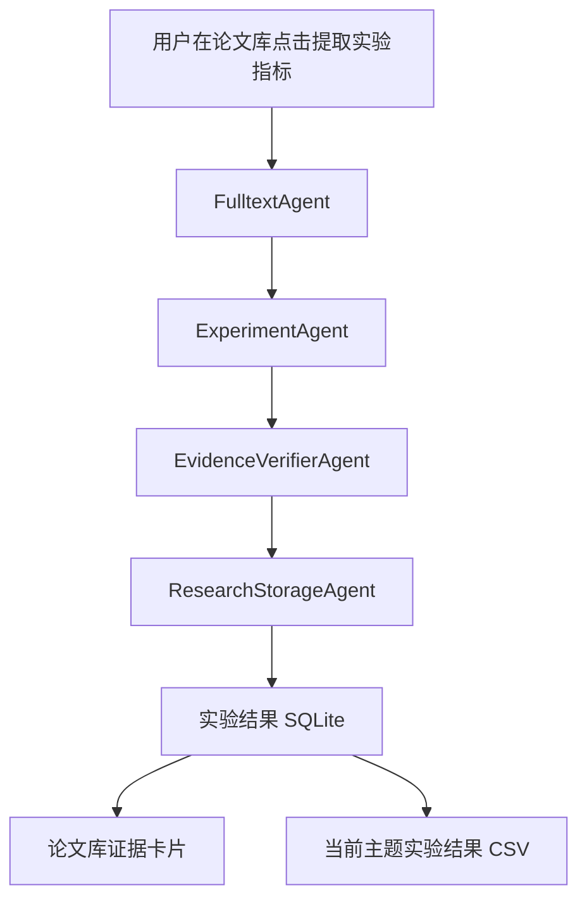

# Paper-Radar v1.14.0：科研实验分析 Agent 设计与验收

版本：1.14.0 ｜ 2026-11-04 ｜ 范围：已有本地 PDF 的实验数值抽取和证据核验

## 一、结论与实施边界

本版本在原九 Agent 日常检索流水线之外，新增一条**用户主动启动的、四阶段科研分析流水线**。主要解决两个长期问题：一是把原有“全文证据卡片”中的实验内容整理为可复用的结构化记录；二是把大模型给出的数字、指标和对照基线锁定到同一段可核验的 PDF 原文，避免在多个段落之间拼接推测。

新流水线处理的是研究人员**已经合法获取并保存在 `downloads/` 中的 PDF**。它不自动登录出版社、不绕过付费墙、不提供 OCR，也没有宣称能解析复杂公式或跨行表格。AI 提取结果是研究辅助数据，不能直接用于投稿、技术评估或实验效果排名，必须由作者复核。

## 二、Agent 组织与数据流



| Agent | 文件 | 输入 | 输出 | 外部行为和失败规则 |
|---|---|---|---|---|
| FulltextAgent | `agents/research/fulltext.py` | 论文 ID、已保存 PDF、全文索引 | `pdf_document`、最多16个全文片段、证据映射 | 本地文件与 SQLite；索引缺失时调用已有 `index_paper`；失败终止 |
| ExperimentAgent | `agents/research/experiment.py` | 当前论文片段、模型配置 | 有界 JSON 候选项或有效缓存命中 | 仅用户点击后调用云端模型，最多一篇；不自动重试计费操作 |
| EvidenceVerifierAgent | `agents/research/evidence.py` | 候选 JSON、证据映射 | 通过校验的实验记录 | 不调用模型、网络和文件写入；拒绝所有不合格记录 |
| ResearchStorageAgent | `agents/research/storage.py` | 核验结果、PDF 指纹、缓存签名 | 入库统计或安全空结果 | 写入 `experimental_findings`；入库前再次校验文件未替换 |

按需工作流的注册位置：`paper_radar/agents/research/pipeline.py`。主九 Agent 定时检索不自动触发它，因此日常检索不会产生新增模型调用费用。两个工作流共用已有 `AgentRunner`、能力声明、失败轨迹和成本统计，但不会相互覆盖中间状态。

命令行查看依赖：

```bash
python -m paper_radar.agents doctor
python -m paper_radar.agents research-graph
```

## 三、实验数据字段和真实性边界

结构化结果保留 `kind`（定量指标 / 消融 / 效率）、`dataset`（数据集）、`metric`（指标名称）、`value`（原文数值）、`baseline`（对照基线）、`setting`（可核查条件）、`chunk_id`、`page`、`quote`、`pdf_sha256` 及提取版本签名。

**证据门槛：**

1. 只接受 JSON 对象中的 `findings` 数组；最多处理36个候选，最终最多保留12条。
2. 每条必须包含可定位的整数片段编号、连续原文引文、指标名及含数字的结果值。
3. 引文必须出现在本次向模型提供的相应片段中。指标、数值、数据集、基线和实验条件均需能在这段引文中逐字定位。
4. 不支持跨原文片段自动拼接，也不自动补齐表头、跨行数据或不同图片中的实验设定。
5. 结果值不做数学单位换算；不基于一个结果推导百分比提升。模型给出的新增数值必须能回到原文引文。
6. 相同片段、指标、数值和引文的重复项合并；格式错误、无依据字段、伪造引文和超长输出一律拒绝。
7. 即使全部候选均未通过，也不会保存未经核实的“假结果”，原先已经验证过的成果不会被空模型回答覆盖。

这些措施检查的是“模型陈述是否与同一原文片段一致”，并不能保证论文实验设计科学、数值本身正确、不同论文的指标定义可比较。复杂表格可能使可接受结果较少，这属于当前的保守策略。

## 四、PDF 指纹、缓存和数据库升级

数据保存在已有 `data/papers.sqlite3` 新增的 `experimental_findings` 表中，原始元数据、主题分数、阅读状态及 PDF 保存方式不变。分析缓存签名包含 PDF 的 SHA-256、模型提供方、模型名称、API 地址和提示词版本。

- 调用模型之前用 `paper_status` 核实本地 PDF 与索引版本一致。若 PDF 尚未建立索引，则先执行已有本地索引流程。
- 模型调用返回后，入库阶段再次计算 PDF 文件指纹；文件被替换时拒绝保存新结果。
- 用户在程序外替换 PDF 后，状态页和当前主题的导出功能不再显示旧版本证据。
- 同一文件、同一模型和同一提示词配置重复分析时复用有效缓存，不重复调用模型。改用其他模型则重新提取。
- 无依据模型回答不覆盖上一次有效版本。现阶段不在管理界面提供“强制重新分析”的按钮；需要改变模型版本或后续设计显式失效功能。

旧数据库无需人工执行 SQL。新表会在首次查看实验分析状态或运行提取时自动建立。升级前仍应完整备份 `settings.json`、`data/`、`downloads/` 和 `reports/`。

## 五、用户操作与数据输出

1. 正常检索并下载合法开放的 PDF。
2. 在“论文库”找到已下载论文，点击“全文证据”。
3. 点击“解析本地 PDF”（纯本地操作）；若未解析，实验 Agent 也会尝试建立索引。
4. 点击“提取实验指标”，阅读云端发送及可能费用提示，然后确认。每次只处理一篇论文、最多16个原文片段。
5. 等待任务结束；回到当前弹窗查看实验指标、数据集、对照、页码和原文引文。点击对应的 PDF 页面核实。
6. 在“研究报告”点击“导出实验数据证据索引”，保存当前活动主题内经过验证且 PDF 未变更的数据。导出结果为 `实验结果证据索引.csv`，对任意一个研究主题单独生成。

CSV 包含论文 ID、题名、DOI、原文链接、类别、数据集、指标、数值、对照、条件、PDF 页码、原文引文和“需人工复核”的比较说明。所有单元格经过电子表格公式注入防护。**导出 CSV 的数值仅保持原文表达，不自动计算排名、加权平均、显著性或跨论文性能提升。**

## 六、接口和开发测试

- `GET /api/experiments/status?paper_id=<ID>`：返回 `paper_id/status/findings/note`；未找到论文返回 HTTP 404；PDF 变动时返回 `stale` 且清空结果。
- `POST /api/job`，`{ "mode":"analyze_experiments", "ids":["paper-id"] }`：在后台启动按需分析，受原本地 CSRF Token、Host、任务锁保护；HTTP 202 仅表示接受请求。
- `POST /api/job`，`{ "mode":"export_experiments" }`：导出当前研究主题实验 CSV；不调用模型。
- `GET /api/agents`：继续返回九 Agent 的日常执行情况，`on_demand` 增加实验分析服务入口。
- 自动化测试：`python -m pytest tests/test_v114_research_agents.py -q`；所有测试可使用模拟模型响应，无真实密钥及网络依赖。

专项测试重点覆盖：原文片段内容核验、数据集/基线/数值伪造、CSV 注入防护、跨主题导出隔离、异常回答不覆盖有效结果、缓存复用、PDF 中途更换、状态路由和 CSRF 拦截。

## 七、局限与下一阶段优先级

**P0：表格保真与实验条件建模。** 当前 `pypdf` 主要返回文本层，无法可靠重建复杂表格关系。下一阶段可引入可选 Docling/GROBID 等布局解析器，在离线样本上逐页评价列结构、合并单元格、表注和公式位置。只有经过真实标注验收才可放宽“同一引文”的保守限制。

**P0：实验指标可比性判断。** 新建实验条件实体，纳入数据划分、任务、评价指标数学定义、对照设置、算力与随机种子；不同论文的结果默认为“不可直接比较”。

**P1：研究进展汇总 Agent。** 在稳定的实验证据上生成专题比较、方法矩阵和逐周变化记录，并保持每个结论可点击回原文。

**P1：任务隔离和恢复。** 对第三方 PDF 解析采用可退出的子进程、内存上限及硬超时；对已经付费调用的结果采用持久任务 ID 和显式重试策略，避免失败后重复计费。

**P2：个人文献 RAG。** 基于论文级证据索引提供有出处的跨论文问答。增加本地向量搜索前应先建立召回质量和事实准确性测试集。

当前版本不宣称实验解析准确率已经提升，也不宣称真实云端、Windows 计划任务、授权出版社 PDF 已完成实机验收。
