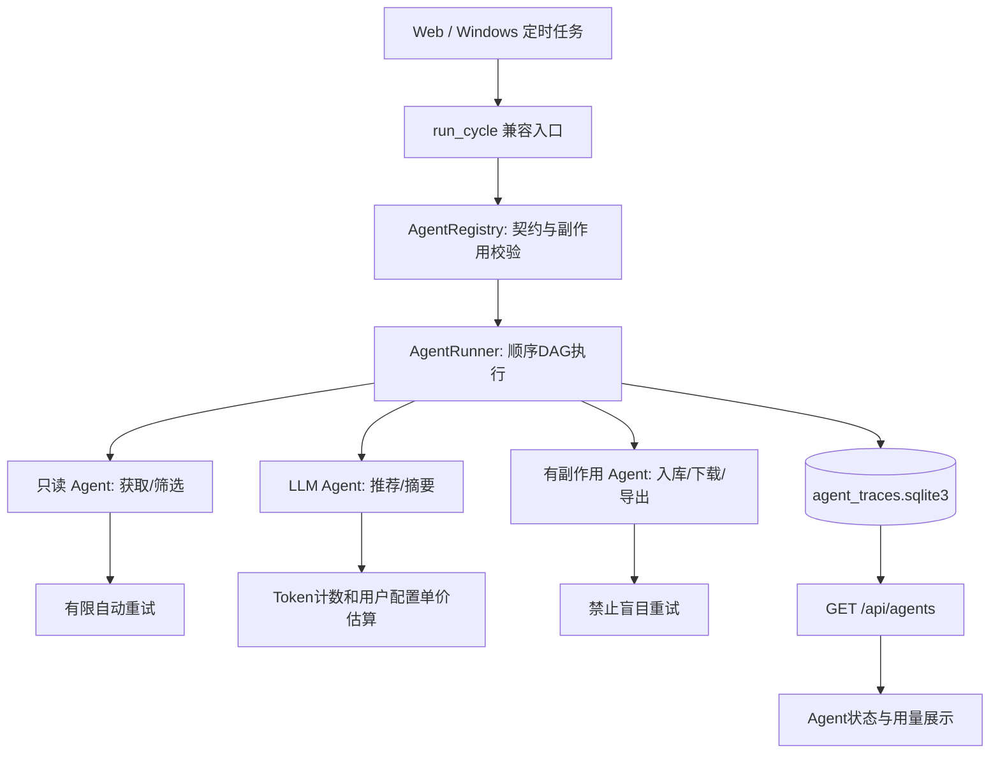

# Paper-Radar v1.13.1：Agent 运行治理与独立研发技术方案

**发布日期：2026-11-04**  
**基线版本：v1.13.0**  
**本轮目标：控制副作用、提升可靠性、可观察模型成本，并允许 Agent 单独开发测试。**

## 一、结论与现状

v1.13.0 完成九个 Agent 的职责拆分、依赖图、运行轨迹与降级处理，但对每个阶段的时间预算、异常重试和 API 费用归属缺少统一契约。本轮采取有限、可验证的改造：扩展 `AgentSpec` 的运行声明；编排器实现有边界的重试与协作式时间预算；增设代码级能力检查、Token 归属和本地诊断；保留既有 SQLite / Web / 计划任务接口。

**已实现：** 运行预算、只读步骤可控重试、取消检查点、故障注入测试入口、应用级能力声明、单 Agent Token 统计、可选费用估算、Web 视图、离线 doctor 和对应测试。

**尚未实现：** 强制杀死超时 Python 调用、跨进程任务恢复、每个模型单独计费路由、任何操作系统级 Agent 沙箱、云端服务商完整账单同步、按需 Agent 全量迁入编排器。上述项目必须单独验收，不能将本版称为“完全隔离”或“自动精确计费”。

## 二、运行架构



保留所有原有依赖关系和数据模型。应用无外部工作流引擎依赖，也不根据论文内容自动执行任意程序。

## 三、核心契约与落地文件

| 契约/功能 | 源码 | 已实现行为 |
|---|---|---|
| 能力声明 | `agents/contracts.py` | `capabilities` 显式列出网络读取、Zotero 读取、数据库读写、文件写入和云端模型能力 |
| 执行预算 | `agents/contracts.py` | `time_budget_seconds`，支持 `ctx.checkpoint()` 协作式取消和检查超时 |
| 重试策略 | `agents/runtime.py` | `max_attempts` 允许 1—3 次，退避延迟上限 3 秒；只处理可判定的暂时性异常 |
| 副作用保护 | `agents/runtime.py` | 具备数据库写、文件写、模型计费能力的 Agent 无法注册自动重试策略 |
| 输出与隐私 | `agents/runtime.py` | 禁止未声明的产出字段，异常轨迹只保留类型，过滤非有限数字指标 |
| 模型用量 | `provider_usage.py` | `ContextVar` 绑定当前 Agent，保留服务商总计数，同时按 Agent 汇总已上报 Token |
| 费用估算 | `core.py`、`runtime.py` | 用户手工设置每百万输入/输出 Token 美元价格；仅有价格时输出估算值 |
| 状态与交互 | `static/index.html`、`static/app.js` | 显示 Agent 执行状态、重试次数、耗时、模型 Token 和超时预算提示 |
| 诊断 | `agents/__main__.py` | `python -m paper_radar.agents doctor` 本地校验注册模块入口，无网络请求 |
| 故障测试 | `tests/test_v131_agent_runtime.py` | 模拟暂时性错误、永久异常、超时、取消、Token 计数、越权能力与缓存边界 |

## 四、九个 Agent 的运行策略

| Agent | 声明的资源能力 | 自动尝试次数 | 协作式时间预算 | 故障策略 |
|---|---|---:|---:|---|
| Profile | zotero_read | 1 | 180s | 停止 |
| Discovery | network_read | 2 | 1800s | 停止 |
| Quality | 无外部权限 | 1 | 180s | 停止 |
| Ranking | cloud_model, database_read | 1 | 900s | 降级 |
| Storage | database_write | 1 | 600s | 停止 |
| Summary | cloud_model, database_write | 1 | 3600s | 降级 |
| Download | network_read, database_write, filesystem_write | 1 | 3600s | 降级 |
| Selection | database_read | 1 | 180s | 停止 |
| Report | filesystem_write | 1 | 600s | 停止 |

**重要限制：** `time_budget_seconds` 由 `AgentContext.checkpoint()` 在执行前后及部分进度回调中检查。正在阻塞的第三方函数、网络底层调用或 C 扩展不能由该机制强制终止；各 API 和下载器仍须设置自身网络超时。对于需要真正强制超时的 PDF 解析或未知外部插件，应在后续版本改用子进程执行，并增加原子提交/临时目录清理。界面中的“超出预算”仅表示超过配置的运行预算。

**重试原则：** Discovery 的输入阶段只读取外部资源，可以对网络暂时故障再试一次；Python 解析错误、用户授权失败和写入磁盘失败不会被当成可重试故障。Summary/Ranking 可能已经产生模型费用，Storage/Download/Report 可能已有写入副作用，因此均不盲目重试。源适配器内已实现的限速与子查询错误处理仍然生效。

## 五、模型 Token 与费用

当前 `cloud_api.chat_completion` 在服务商返回 `usage` 时记录输入/输出 Token；缺失 `usage` 的兼容服务商会记录一次成功调用，但 Token 可能为零。`provider_usage.py` 将本地执行上下文绑定到当前 Agent，使每一段运行轨迹可包含：

```json
{
  "agent": "summary",
  "state": "success",
  "attempts": 1,
  "api_usage": {"requests": 2, "input_tokens": 9200, "output_tokens": 2400},
  "estimated_cost_usd": 0.0112
}
```

上述数值为 **格式示例，不对应真实收费或执行记录**。估算公式为：

`estimated_cost_usd = (input_tokens * input_price + output_tokens * output_price) / 1,000,000`

输入/输出价格由用户在 **设置 → 中文速览 → 模型费用估算** 中手动填写，单位为美元/百万 Token；都为零时，不输出零费用的误导性结果。模型服务商的缓存折扣、计费区间、附加服务及预付额度没有自动纳入估算。对账仍以实际供应商账单为准。

指标持久化到 `data/agent_traces.sqlite3`，最多保留既有的 300 条运行记录。**不存储**提示词、全文、API Key、模型回答。`ContextVar` 只关联同线程同步模型请求；未来如 Agent 内部自己启动线程或进程，需显式实现跨执行上下文用量聚合与隔离。

## 六、数据访问治理与局限

声明的能力包括 `network_read`、`zotero_read`、`database_read`、`database_write`、`filesystem_write` 和 `cloud_model`。代码可在执行外部操作前调用 `ctx.require('database_write')` 等应用层检查。注册表拒绝未知能力、重复能力，以及云端 Agent 未声明云端能力等错误。写入类 Agent 禁止自动重试。

这些约束适用于**项目维护的内置 Agent 的显式访问入口**。Python 进程内的被信任代码仍可能导入其他模块并直接访问本地文件；当前没有对恶意第三方 Agent 提供操作系统级隔离。外部 Agent 不支持通过配置文件动态加载。若未来引入不可信插件，需要独立进程、最小化文件系统挂载、隔离网络与机密凭据，不能仅依靠 `ctx.require()`。

`AgentContext.state` 目前在一次任务中共享 Python 对象，尚未实现强制只读对象封装；需要持续测试每个 Agent 的字段所有权，避免在上游失败后直接污染共享实体。

## 七、独立 Agent 研发与检查流程

```bash
python -m paper_radar.agents list
python -m paper_radar.agents graph
python -m paper_radar.agents doctor
python -m paper_radar.agents traces --topic default
python -m pytest tests/test_v131_agent_runtime.py -q
python -m pytest -q
python -m compileall -q paper_radar main.py
node --check paper_radar/static/app.js
```

建议每个独立 PR 提供：模块契约变更、需要的能力列表、外部成本估算、至少一个失败注入测试、日志无密钥检查、旧版数据库兼容性结论和完整回归结果。修改 `AgentSpec` 之后必须同步 Agent 版本、README 与更新日志。

`AgentRunner.run(..., faults={'discovery':[TimeoutError('injected')]})` 仅是测试代码的故障注入接口，不在本地 HTTP 中开放，不能作为用户侧控制运行内容的入口。此接口可验证读取型 Agent 的重试与故障状态。

## 八、下一阶段建议（未实现）

1. **v1.14：全文 Agent 标准化与结构化实验信息。** 把已存在的 `fulltext.py` 显式拆为 `FulltextAgent`、`EvidenceVerifierAgent` 与 `ExperimentAgent`；证据包含文献版本、页码、片段哈希，实验指标必须说明数据集、比较基准和表格位置。
2. **v1.14.x：真正的超时隔离与幂等检查点。** 使不可信 PDF 解析在可终止子进程中运行；下载与导出使用临时文件和完成提交标记，支持断点续跑。
3. **v1.15：多论文技术比较与人工基准评价。** 以主题级标注集评估 P@10、NDCG、引用准确率及成本变化；将多论文对比中的异构实验条件明确标注为不可直接比较。
4. **v2.0：研究知识库与问答。** 按主题检索，逐条给出可验证原文证据与来源，避免自动把未核实结论写成确定事实。

## 九、验收边界

本轮代码测试在 Mock 网络/模型、临时 SQLite、可控异常和已有单元/集成测试上完成。真实 Windows 计划任务、真实出版社 API、不同 Zotero 桌面版本及付费模型价格仍需用户环境验收；未进行真实云端计费试验。功能升级不会凭空提高检索召回率、推荐准确率或全文科学结论正确性，应使用真实论文评估集另行测定。
