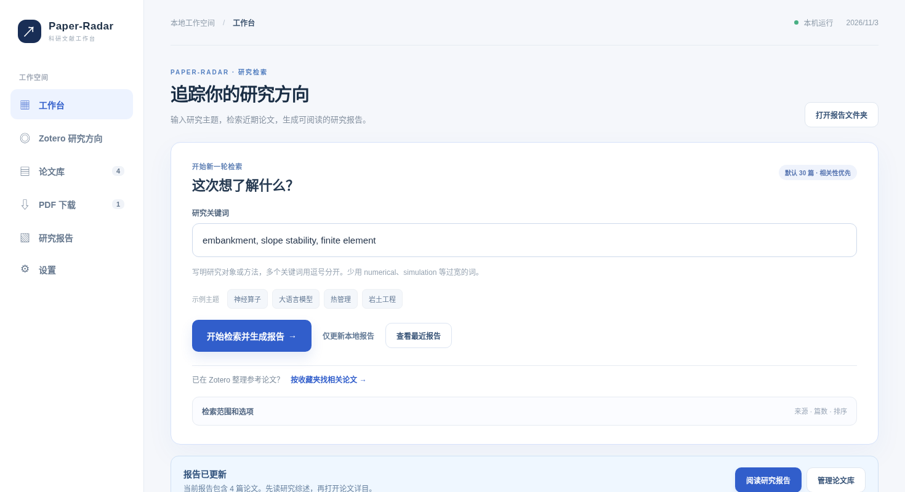
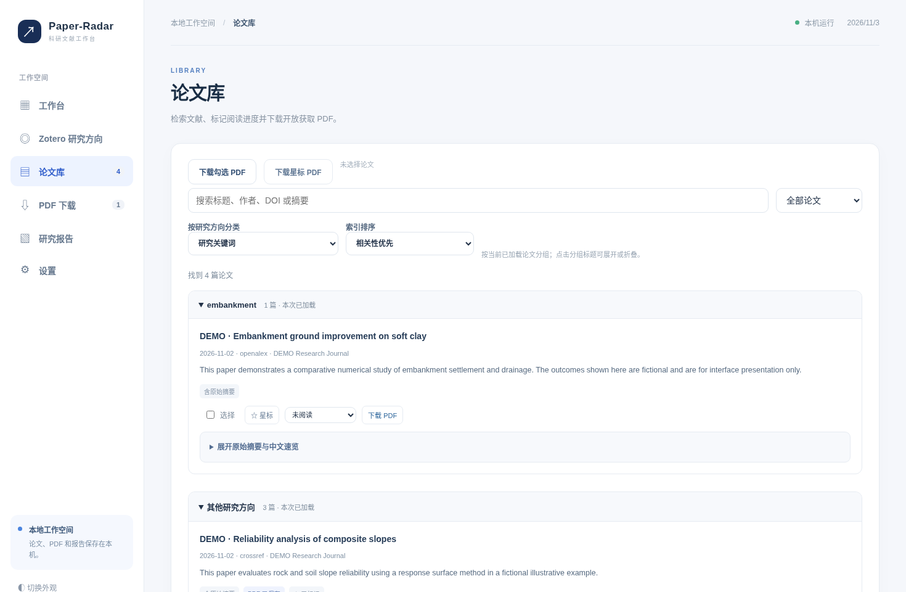
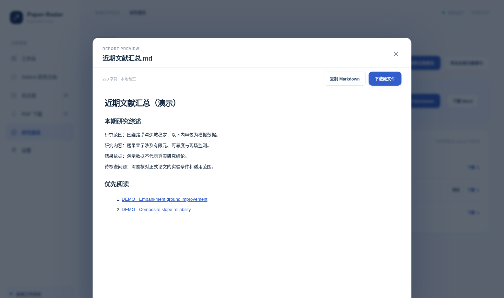

# Paper-Radar v1.9.0：代码、界面和报告质量审阅

版本：1.9.0　｜　项目：https://github.com/QiQiWan/Paper-Radar　｜　© 2026 @EatRice

## 1. 本次审阅的依据

本次审阅同时检查了 v1.8.0 源码和用户实际生成的 `reports.zip`。文件包括近期 Word 汇总、Markdown 汇总、新增论文 Word 及30条文献的 CSV 索引。源码检查包括前端页面、检索源适配器、相关性排序、日期过滤、报告生成、Zotero、任务进度、PDF 下载、HTTP 接口和开源配置。

报告样例的研究词包括 `embankment`、`hypoplasticity`、`plaxis`、`surface settlement`、`tbm` 等，同时包含宽泛的 `numerical`。原始30篇中，20篇日期不在指定的最近7天范围内或日期不完整；其余10篇中，7篇主要依赖宽泛词入选，或者没有足够的直接研究主题证据。按最终代码规则重新筛选，保留3篇。此数值是对用户已上传题录的离线复核，尚未重新联网抓取。

## 2. 核心问题与改进原则

原首页同时显示检索源、API、报告、下载、后台任务和若干说明，缺少明显的主任务。论文库一页长英文摘要过多，筛选控件、批量按钮和分组入口同级排列，阅读负担较重。报告的自动综述出现了与岩土领域无关的技术标签，论文的研究对象、方法、主要发现和证据来源没有清楚区分。原报告还存在未来日期混入“最近7天”、只凭 `numerical` 入选等问题。

新的使用流程按以下顺序组织：**填写主题 → 运行检索 → 看本次结果 → 阅读优先论文 → 导出 Word/Markdown**。Zotero、出版社密钥、模型 API、自动下载和后台任务作为按需展开的辅助功能。界面首先让读者完成一次有结果的检索，再引导个性化设置。

## 3. 逐项整改清单

| 编号 | 优先级 | 发现的问题 | 本轮改动 | 验收情况 |
| --- | --- | --- | --- | --- |
| 01 | P0 | 首页主任务被设置卡片淹没 | 独立醒目的主题输入和主检索按钮 | 已完成；界面截图验收 |
| 02 | P0 | 本次检索结果不容易找到 | 在输入区域下方集中显示收录数、当前主题、PDF 数和运行结果 | 已完成 |
| 03 | P0 | 高级检索参数占据首屏 | 来源、数量、排序默认收起 | 已完成 |
| 04 | P0 | 每日定时任务混入首次使用流程 | 调整为折叠区，保留安装/停止/手动运行 | 已完成 |
| 05 | P0 | 初次使用不清楚下一步 | 增加首次检索引导，保留直达 Zotero 入口 | 已完成 |
| 06 | P0 | 数量较大时论文卡片非常长 | 卡片只显示短摘要，原始摘要展开阅读 | 已完成 |
| 07 | P0 | `numerical` 等宽泛词可能单独触发收录 | 抽取精确研究词，宽泛词仅作为低权重加分 | 已完成；回归测试 |
| 08 | P0 | 未来日期可能进入最近7天报告 | 检索入库前检查日期上界与下界 | 已完成；回归测试 |
| 09 | P0 | 日期缺失也被当作近期 | 缺完整日期的题录不进入当期检索结果 | 已完成；数据复核 |
| 10 | P0 | 只有标题的论文被写成有明确研究结论 | 标注“仅题录”，明确提示无法判断方法和结果 | 已完成 |
| 11 | P0 | 自动主题识别容易跨领域误判 | 分离岩土研究对象、数值方法与代理模型标签 | 已完成；针对性测试 |
| 12 | P0 | 从 `underpinning` 等词误判 PINN | 排除宽泛子串规则，按完整技术短语识别 | 已完成 |
| 13 | P0 | 本期综述不够具体且缺证据 | 增加主题分布、代表论文方法、摘要结果依据和未确认事项 | 已完成；以输入摘要为边界 |
| 14 | P0 | 优先阅读段落只有题录信息 | 展示方向、方法、摘要结果句和原文链接 | 已完成 |
| 15 | P0 | API Key 可能泄露在开发日志 | 保留状态码与非敏感错误信息，避免输出密钥 | 保留原有防护 |
| 16 | P1 | 设置选项数量多、首次理解成本高 | 统一将高级控制集中到设置页，并精简首页提示 | 已完成一部分；复杂设置页后续仍可拆分 |
| 17 | P1 | 检索数量过大易造成信息过载 | 默认30篇；允许高级配置 | v1.8已有，本轮保留 |
| 18 | P1 | Zotero 自动提词可能不准确 | 允许人工编辑，保留选择收藏夹和查看参考论文 | 已有功能，强化说明 |
| 19 | P1 | Markdown 浏览需要下载打开 | 报告页预览弹窗，提供复制和下载 | 已有功能，已测试 |
| 20 | P1 | 长任务没有及时反馈 | 检索、模型、下载与导出阶段显示进度和日志 | 已有功能，保留入口 |
| 21 | P1 | 多来源失败与空结果容易混淆 | 不同来源记录状态；全部失败不生成假成功报告 | 已有功能 |
| 22 | P1 | 论文库难管理 | 搜索、分页、星标、阅读状态、关键词及来源分组 | 已有功能；本轮改进摘要长度 |
| 23 | P1 | 原文证据与 AI 生成的中文结论混在一起 | 为中文速览、原始摘要和英文结果句使用单独标签 | 已完成 |
| 24 | P1 | Word 主题分布被泛化词占据 | 宽泛方法词不单独显示为研究主题 | 已完成 |
| 25 | P1 | 大模型摘要容易过度泛化 | 模型提示词要求提取问题、方法、真实结果及限制，无证据则明确写出 | 已完成 |
| 26 | P1 | PDF 下载失败后不好恢复 | 下载页保留失败原因与重试按钮 | v1.8已有 |
| 27 | P1 | 来源权限难理解 | 区分免费题录、需要 API Key、需要机构订阅 | v1.8已有 |
| 28 | P1 | API 用量统计容易被理解为官方剩余额度 | 将本机调用统计与官方余额/控制台分开 | v1.8已有 |
| 29 | P1 | 公众号操作截图与程序版本不一致 | 统一 v1.9.0 界面截图和文字、补真实实机截图清单 | 已完成文稿；待用户实拍 |
| 30 | P1 | 本地接口无法在某些浏览器测试环境直接访问 | 分离 HTTP 集成测试与前端模拟交互 | 已完成；真实设备仍需验收 |
| 31 | P2 | 多个研究主题需要反复切换 | 保存多套主题配置及独立定时规则 | 后续开发 |
| 32 | P2 | 主题组内数量随分页变化 | 增加服务端全量聚合统计 | 后续开发 |
| 33 | P2 | 只有关键词精确匹配，仍有召回不足 | 增加 BM25、Embedding 和基于引用的重排，人工确认阈值 | 后续开发 |
| 34 | P2 | 出版社检索响应和授权稳定性差异大 | 每个来源统计成功率、延迟和配额 | 后续开发 |
| 35 | P2 | PDF 全文信息没有用于结构化研究综述 | 对用户已授权的开放 PDF 做全文提取和页码证据定位 | 后续开发 |
| 36 | P2 | Zotero 当前只读，成果回流需要手工操作 | 可选导出 RIS/BibTeX，后续经用户确认后写回 Zotero | 后续开发 |
| 37 | P2 | 历史进展主要靠单次报告查看 | 跨周新增主题、方法、文献关注度比较 | 后续开发 |
| 38 | P2 | 首次安装仍需 Python 环境 | Windows 原生安装包及签名发布 | 后续开发 |

## 4. UI 与人机交互的验收标准

以首次使用为例，首页无需展开任何高级区域，即可找到输入框和主操作按钮；运行后顶部可以看到阶段和日志入口；完成后可以直接进入报告或论文库。论文详情提供“短摘要 / 展开完整摘要”两级阅读。在390px宽度的移动端，导航不会导致整页横向溢出。不能准确估计的网络等待不承诺固定剩余时间。

## 5. 研究报告的内容标准

**首先核对检索边界。** 仅把有完整发布日期、且处于设定日期区间的论文纳入近期报告。对宽泛主题词做低权重处理；对只有题录、没有摘要的文章保留人工核对标签。

**每篇论文的阅读要点按证据层级写：** 研究对象与问题、摘要中出现的方法、原始摘要中的结果句、需要阅读原文确认的条件。云端模型生成的中文速览单独展示，避免与真实摘要证据混淆。重要数字必须能在原摘要中找到。

**本期研究综述放在“本期概览”和“优先阅读”之间。** 开篇说明关键词和研究方向，再写本期覆盖的主要对象及方法，最后提出应重点核查的适用范围、实验条件和证据不足。没有可支持的证据时直接留空或标注信息不足，不编造研究趋势。

## 6. 原始 reports.zip 的复核结论

原始数据30篇；时间范围失配或日期不完整20篇；剩余中依据过宽关键词、主题相关性不足而排除7篇；保留3篇。其中1篇缺摘要，因此只能开展题录级初筛。留存文献主要涉及软土地基路堤加固、土岩组合边坡可靠度，以及铁路路基现场沉降。坡面侵蚀论文缺少与当前关键词的直接匹配，最终被排除；如研究主题包含水土保持，可另建对应检索主题。

**复核限制：** 这是对用户上传的既有题录执行本地过滤，没有验证上游出版商原始索引、更没有重新全量检索网络文献。新报告中的每条论文仍应点击 DOI/期刊页面核对正式发表状态。

## 7. 发布前未完成的实机验收

当前源代码中的自动化测试、前端模拟操作和 Word 排版检查可以验证程序逻辑，仍不能代替真实 Windows 或 macOS 的完整使用试验。需要逐项核对 Zotero 本机 API、实际学术网站检索、出版社受限来源、DeepSeek 账号调用、PDF 原站下载、Windows 后台任务和不同网络环境。请按另附《真实截图补充清单》拍摄并标记验收结果。
