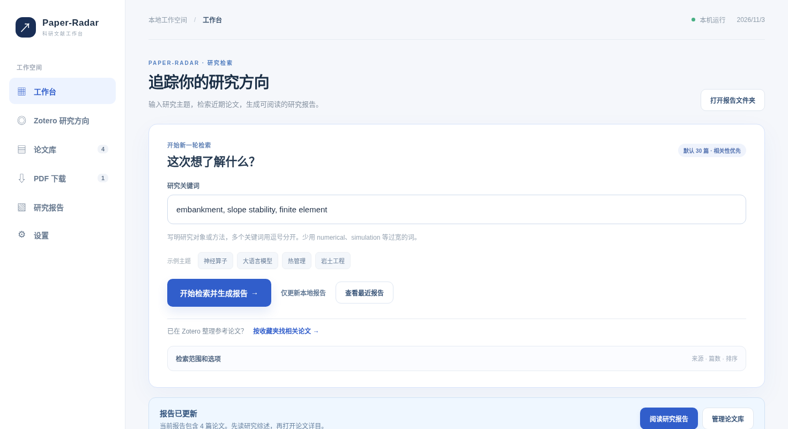
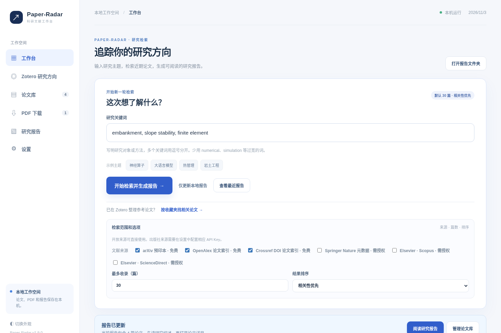
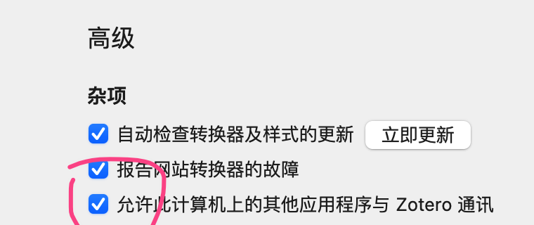
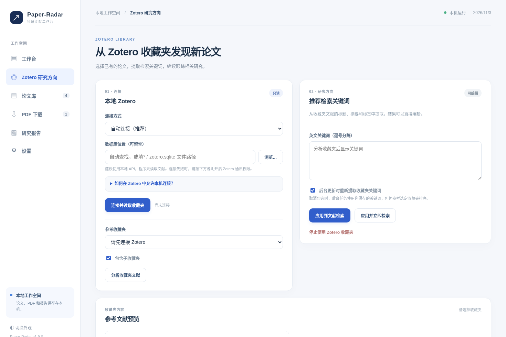
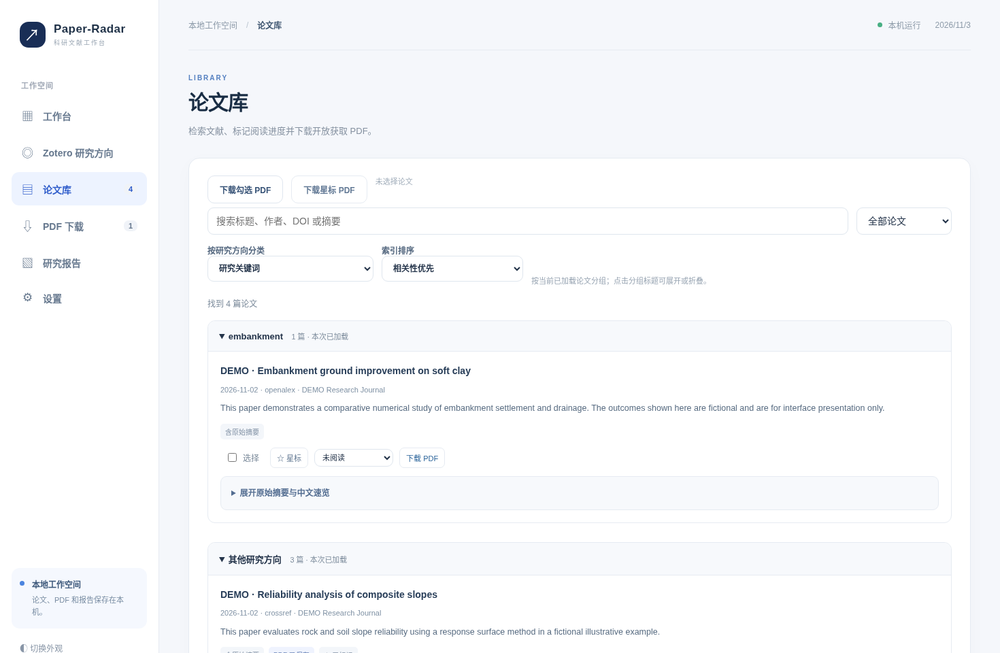
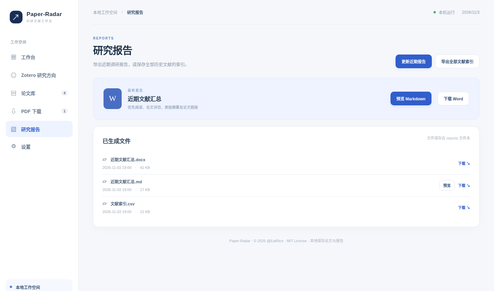
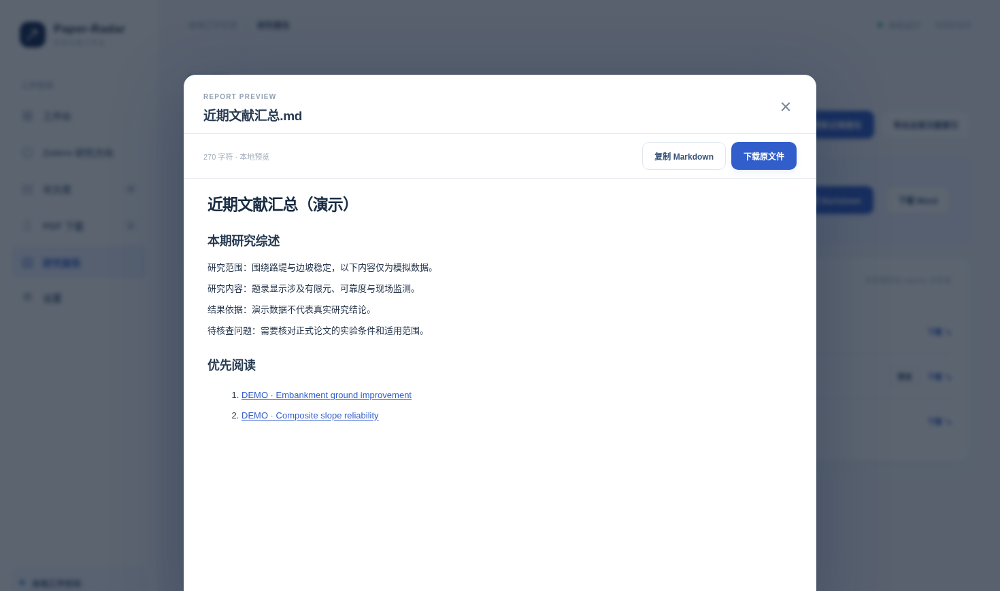
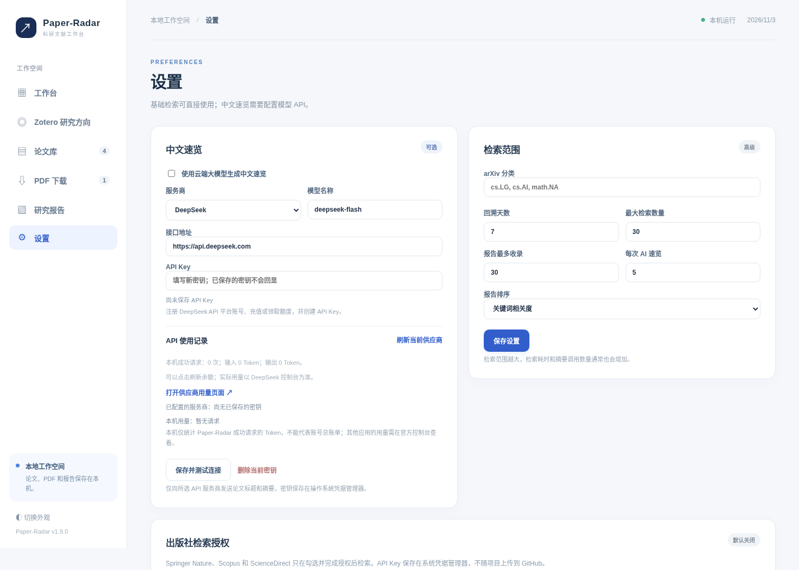

# 我把自己的论文追踪流程做成了 Paper-Radar：从找新论文到生成 Word 报告

平时做研究，最费时间的工作之一就是反复打开几个网站，输入相似的关键词，翻标题、看摘要、保存链接。过几天再做一次，又要判断哪些文章看过、哪些是新出现的。

我把这些常用步骤整合进了一个本地工具，叫 **Paper-Radar**。它运行在电脑上，网页负责操作，检索记录、下载的 PDF 和报告都放在本地。代码仓库地址（上传后可下载）：**https://github.com/QiQiWan/Paper-Radar**。

目前它可以检索 arXiv、OpenAlex、Crossref；连接本机 Zotero 收藏夹；整理 PDF 和阅读状态；最后生成 Word、Markdown、CSV。Springer Nature、Scopus 和 ScienceDirect 也有题录检索入口，但需要先取得官方 API 授权，默认没有开启。

## 先用最简单的方式跑一次

第一次使用不需要配置 Zotero，也不需要买模型 API。电脑里安装 Python 3.10 以上版本，将本次发布的源码包解压到固定文件夹，或在 GitHub 发布后从仓库下载。Windows 双击 `start_windows.bat`；macOS/Linux 执行 `sh start_macos_linux.sh`。第一次运行时程序会安装依赖，随后在浏览器打开本地工作台。

左侧进入“工作台”，首页最醒目的位置就是 **研究关键词**。输入你正在关注的术语，例如：

`hypoplasticity, slope stability, PLAXIS, embankment`

尽量把研究对象、方法和工程场景写清楚。以前我试过只用 `numerical` 这样的宽泛关键词，搜索结果里会出现压电器件、电路、流体等各个方向的文章，筛选起来反而更累。

点击 **开始检索并生成报告**。页面顶部会显示当前检索进度，可以展开运行日志，查看 arXiv、OpenAlex、Crossref 分别执行到哪一步。检索结束后，首页直接显示当前主题的论文数、下载的 PDF 数和任务状态。再点 **查看研究报告** 即可进入本次结果。

### 想控制篇数？高级选项里改

默认最多收录30篇，按相关性排序。如果只想快速了解一周进展，30篇通常更容易阅读；做专题调研时，可以展开“检索范围和选项”，把数量提高到50或80，或者切换为按日期排序。

现在系统也会检查题录的发布日期。未来日期、日期不完整的记录不会直接混进“最近7天”报告；仅匹配到 `numerical`、`simulation` 等泛化词的论文，也不会轻易挤掉研究主题更明确的文章。

## 已经在用 Zotero？可以让收藏夹替你提供研究主题

这一功能比较适合已经积累了几十篇相关论文的人。比如 Zotero 中有一个“土体本构及参数反演”收藏夹，里面的题名、摘要和标签就可以作为后续检索的参考。

第一步先打开 Zotero，在 **设置 → 高级 → 杂项** 找到“**允许此计算机上的其他应用程序与 Zotero 通讯**”并勾选。Windows 通常在“编辑 → 设置”，macOS 通常在“Zotero → 设置”。操作位置见下图。

第二步保持 Zotero 打开，切换到 Paper-Radar 左侧的 **Zotero** 页面。连接方式选“自动连接”，点击 **连接并读取收藏夹**，选择需要追踪的那个收藏夹。如果研究文献还分布在子目录，可以勾选“包含子收藏夹”。

第三步点击 **分析收藏夹文献**。程序会根据标题、摘要和标签提取英文关键词，同时显示参考论文，方便你判断关键词有没有跑偏。这里的关键词是可以修改的。遇到过宽的词直接删掉，重要的模型名称、材料类型或工程方法可以手动补进去。

检查完成，点击 **应用并立即检索**。它会用这组关键词去寻找近期文章，并尽量排除 Zotero 中已经收藏过的同 DOI 或同标题条目。

如果本地 API 连不上，可以在 Zotero 高级设置里重新检查通讯开关；另一种办法是选择只读读取 `zotero.sqlite`。这两种方式都不会修改你原有的 Zotero 资料。

## 检索结果怎么管理，才不会越积越乱

几百篇文章集中显示在一页，基本没有阅读价值。现在论文库先按页加载，你可以搜索标题、作者、DOI，或按星标和阅读状态筛选。想按方向看，可以选择关键词、学科、来源、年份分类；点击分组标题即可折叠。

每篇论文默认只展示简短摘要。需要了解具体方法，展开“完整摘要”；认为值得重点读的，可以加星标，或将状态设为“阅读中”。这比直接收藏几十篇 PDF 更容易管理阅读进度。

看到 **下载 PDF** 按钮，说明检索结果里存在可尝试访问的开放获取地址。可以单篇下载，也能勾选多篇批量下载。下载失败会在“PDF 文件”页留下原因和重试入口。需要出版社订阅的论文仍要通过有权限的出版社网站或学校图书馆查看。

## 我更关注最后生成的研究报告

这个工具最主要的输出是 `reports/近期文献汇总.docx` 和 `.md`。Word 方便做科研笔记和团队讨论，Markdown 可以在程序内直接预览，也适合放进自己的知识库。CSV 是完整题录索引，后续可以再用 Excel 或 Python 筛选。

点击 **研究报告 → 预览 Markdown**，会在当前页面打开弹窗。可以快速阅读本期综述、优先阅读与详细条目，无需先下载文件。

这次我还重新调整了报告的写法。以前的综述容易堆技术名词，例如看到“数值方法”就推断涉及物理约束学习、代理模型或 Transformer；如果原始摘要没有提供证据，这样的总结会误导阅读。

新版的 **“本期研究综述”** 放在概览统计和优先阅读之间，先说明本次研究对象和方向，再介绍摘要里出现的方法，最后指出值得在原文中核对的问题。逐篇条目也会标明研究方向、方法、原摘要中的结果句和来源链接。缺摘要的文章会直接标注为“仅题录”。

举个真实例子：我用一份已经生成的岩土工程报告复核，原先30篇题录中，有20篇日期不符合“近7天”，另外7篇缺少明确的研究主题匹配依据，严格复核后保留3篇。保留的题录涉及软土地基路堤加固、土岩组合边坡可靠度和铁路路基沉降；坡面侵蚀文章与当前关键词的对应关系较弱，因此未进入自动入选名单。这里的数字只来自这份已上传报告的离线复核，并没有进行新的全网搜索。

这样的结果数量少一些，但每篇的入选理由更清楚。最重要的是，你能沿着题名、原摘要和 DOI 回到论文来源，而不用相信一段没有出处的自动总结。

## 想读中文速览，可以接一个 DeepSeek API

基础检索和 Word 导出都不依赖大模型。需要将英文摘要整理为中文时，可以打开 **设置 → 中文速览**，启用云端模型，选择 DeepSeek。在 https://platform.deepseek.com/ 创建 API Key，填入后点击 **保存并测试连接**。使用模型会按照服务商规定计费。

豆包、OpenAI API、Claude、通义千问、智谱 GLM、Gemini 等也提供快捷配置，但不同服务商需要的模型 ID、接口地址和权限并不完全一样。首次使用建议先验证一种模型能正常调用，再增加其他平台。

## 最后，把它设置成每天自动更新

如果在 Windows 电脑上长期使用，可以在工作台底部展开 **每日自动更新**，选择每天运行时间，点击 **开启后台更新**。系统利用 Windows 计划任务执行一次独立检索进程，完成后退出。浏览器可以关掉，但电脑仍需开机、联网，并满足任务的用户权限。

每次生成的 Word、Markdown 和 CSV 文件保存在本地。需要排查时，进入“设置 → 运行记录”查看手动任务或后台任务的日志。

目前我还在继续改进主题管理、跨周研究趋势分析和更精细的论文重排。真实学术 API、出版社授权、Zotero 资料结构以及 Windows 定时任务仍需要在实际电脑上逐项核验。

Paper-Radar 项目仓库：**https://github.com/QiQiWan/Paper-Radar**

版权：**© 2026 @EatRice**，代码按照 MIT License 提供。实际安装和截图步骤见仓库使用手册，图中展示的界面数据若为演示，会在图片说明中注明。

---

## v1.10.0 版本补充：多主题、多关键词检索与版本提醒

如果你同时追踪两个方向，可以在工作台顶部新建不同研究主题。每个主题会保留自己的关键词、来源和 Zotero 收藏夹关联，Word 与 Markdown 报告也会分目录保存。各主题仍共用论文库和下载的 PDF。目前 Windows 自动计划任务按照执行时选中的主题运行。

关键词较多时，新版可以对 OpenAlex、Crossref 等来源逐组查询，默认最多使用8组关键词，减少过去只有前几组检索词参与查询导致的漏检风险。请求次数增加也可能消耗更多接口额度，所以可以在设置里自行降低查询组数。系统仍然需要用户检查报告的相关性和证据。

运行本地工作台时，还会后台检查本项目 GitHub 是否已经发布更新。检测到更高的**正式 Release**，首页显示提醒，用户点击后到 GitHub 官方页面阅读发布说明并自行升级。系统不会替换本地代码或研究数据。要关闭自动检查，可到“设置 → 软件更新检查”，仍能手动查询。升级前请完整备份工作目录，详细步骤见 [更新指南](UPDATING.md)。

**配图更新要求：** 本文上方图1—图6仍为 v1.9 流程示意；正式发布 v1.10.0 公众号图文时，请重新截取以下真实图片替换或补充：①主题选择器及新建/切换界面；②多查询预算与来源运行状态；③设置页的“软件更新检查”；④模拟发现新版本的通知条（必须明确注明模拟提示）；⑤新主题报告文件夹与页面。截图应隐藏 API Key、真实私人文献内容和个人路径。软件更新提醒只有 GitHub 公开正式 Release 发布之后才会在旧版客户端中实际触发。

## v1.11.0 使用补充（正式发布前请拍摄真实截图）

现在可以把神经算子、热管理等研究方向保存为不同主题，各主题有独立的论文推荐、星标和阅读记录。论文库提供“相关/不相关”反馈；回到相应主题时仍可看到各自的整理进度。如果希望每天依次更新全部主题，可以在工作台“每日自动检索”中开启对应选项。

需要更多探索结果时，可选 OpenAlex 语义发现；需要解释为什么推荐某篇论文时，可选模型标题摘要重排序。两项功能均默认关闭，涉及 OpenAlex 额度或模型 API 费用，使用前需要确认服务商规则。系统会要求模型提供题名或摘要中的原文片段；没有全文依据时，仍需自行检查原文。

**需要补充的真实截图：** （1）研究主题切换；（2）论文库当前主题与全库筛选；（3）推荐理由与原文依据；（4）每日追踪全部主题开关；（5）后台任务历史；（6）启用/关闭可选语义来源。演示截图与真实 API 检索结果应分别标注。

## v1.15.0 公众号教程需要新增的截图与操作

正式公众号教程可增加“开机自动更新、离线照常使用”一节，**首次从 v1.14.0 升级仍需手动安装 v1.15.0**。建议新增：图A（启动 BAT 显示检查 GitHub 与联网情况）、图B（下载更新包与校验结果）、图C（新版启动后的工作台版本号）、图D（设置页启动自动更新开关）、图E（断网时正常启动旧版本）、图F（`.paper_radar_updates/status.json` 的脱敏示例）。所有截图均需从真实用户电脑获取；隐藏本地目录中含个人信息的部分和任何 API Key。正式 Release 创建后再补充官方链接。不得把模拟运行结果描述为真实网络升级成功。
