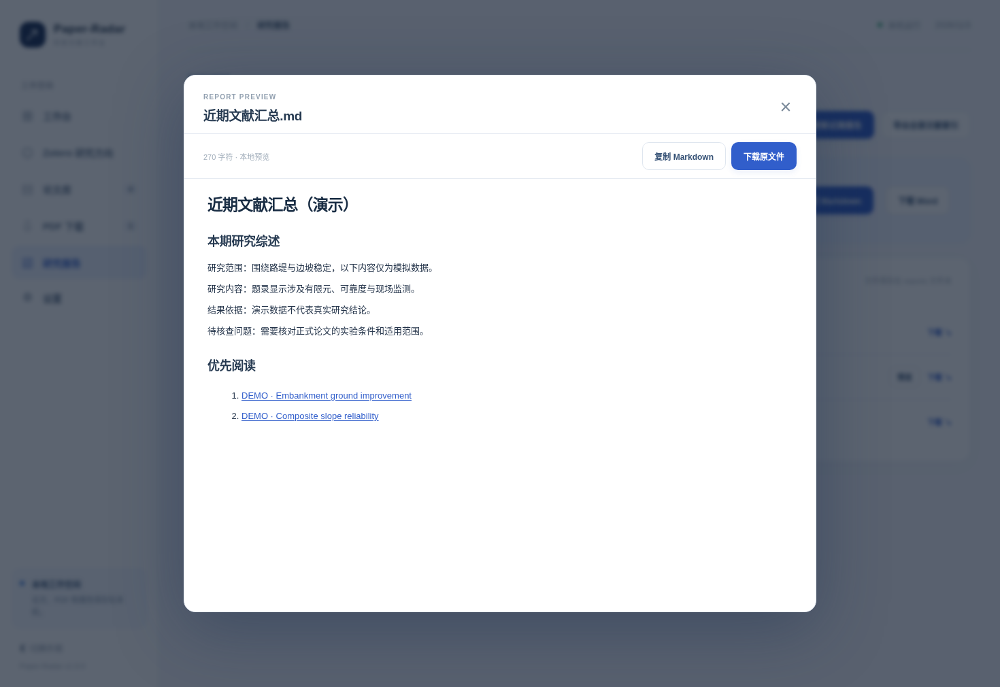

# 研究报告、检索综述与 Markdown 预览

一次检索完成后，默认主题生成 `reports/近期文献汇总.docx` 和 `reports/近期文献汇总.md`，并导出文献索引 CSV；v1.10.0 新增研究主题分别写入 `reports/themes/<主题ID>/`，互不覆盖。左侧 **研究报告** 可重新从本地数据生成文件，或导出包含所有历史文献的 CSV。

## Word / Markdown 结构

1. **本期汇总**：研究关键词、检索日期、收录数量、来源情况等。
2. **本期研究综述**：位于汇总与优先阅读之间。由论文标题、摘要和本期关键词提炼本次检索的主要研究方向、出现的方法以及需要继续验证的问题。
3. **优先阅读**：依据匹配分数和当前研究关键词列出值得先看的论文。
4. **逐篇详情**：题名、作者、时间、来源、DOI、原文链接、摘要、可选中文速览和本地 PDF 状态。

综述是“本次检索中已出现什么”的简要导读，无法证明领域已经取得怎样的整体成果。如果部分摘要缺失，相关描述会受到限制。有关技术贡献、数值指标和问题归纳应回到论文原文核查。

## Markdown 在线预览

报告页点击 **预览 Markdown**，页面会打开本机阅读弹框。预览支持标题、列表、加粗、常见原文链接；内容在本机转换且 HTML 被转义，外链仅允许 HTTP/HTTPS。可以复制 Markdown 或下载文件，再放入 Obsidian、Typora 等编辑器中继续处理。



## 导出与管理

Word 可用于阶段性文献记录与科研汇报，Markdown 适合维护课题笔记，CSV 用于 Excel 排序、筛选与后续分析。论文库历史记录可能比本期30篇多，**本期索引 CSV** 和 **全部历史索引 CSV** 的范围不同。

默认主题文件保存在 `reports/`，其他主题文件保存在 `reports/themes/<主题ID>/`。备份时同时保存 `data/papers.sqlite3` 及个人需要的 PDF；不要将带有个人研究记录的报告上传公共 GitHub 仓库。

## v1.9.0 日期与相关性复核

仅有完整的发布日期且处于设定时间范围内的题录会进入近期报告。`numerical`、`simulation` 等宽泛词不单独决定论文是否入选。报告在每篇论文中单列研究问题、方法线索、原始摘要结果句与待核查条件；没有摘要时标记“仅题录”。

可以使用独立复核命令检查历史导出的 CSV：

```bash
python tools/offline_review.py --input reports/文献索引.csv --keywords "embankment,slope stability,numerical" --as-of 2026-11-03 --days 7 --out reports/review
```

上述日期为演示基准；日常复核请改成实际检索日期。


## v1.10.0 多主题报告归档

切换活动研究主题时，**研究报告**页面会打开当前主题的报告子目录。报告沿用既有 Word、Markdown、CSV 格式和来源状态说明。论文 SQLite、PDF 文件在主题间共享，删除某个主题的配置不会连带删除已经导出的报告。若要长期保留某次结果，建议备份完整的 `reports/` 与 `data/papers.sqlite3`，避免误以为切换主题会创建隔离的论文数据库。
