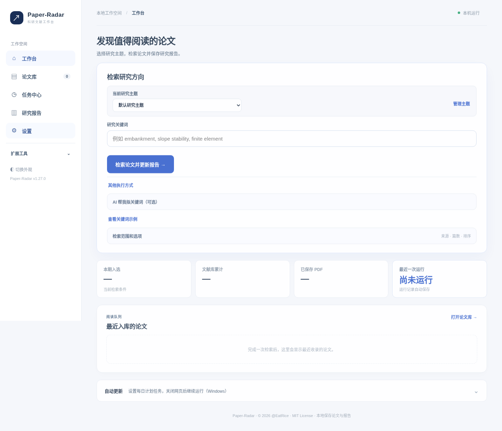
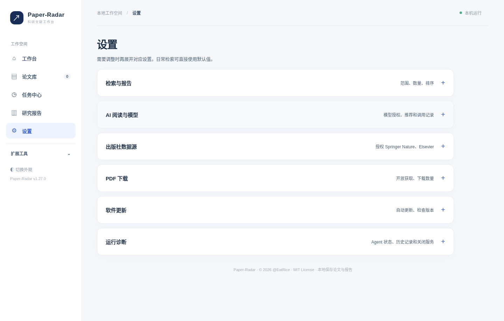
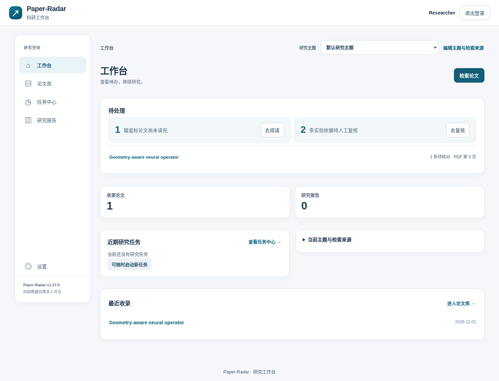
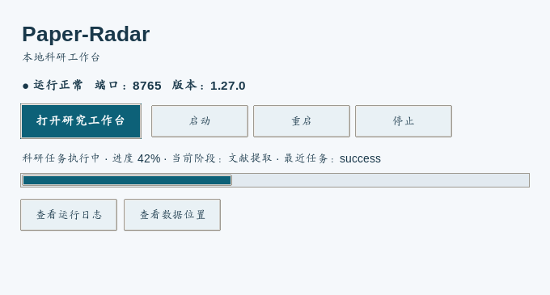

# Paper-Radar v1.27.0 界面精简设计与实施清单

## 1. 改造目标与适用范围

面向以阅读论文、跟踪研究主题、审核实验证据和获取研究报告为主要任务的科研人员。默认页面只展示当前任务必需的操作、结果和错误状态；较少使用的配置通过原生可展开面板按需呈现。涉及云模型费用、上传与论文证据可信性的提示保留在对应操作处。

覆盖：**本地研究工作台（5 个导航入口）**、**公网多用户门户（5 个导航入口）**、**双击启动的桌面服务管理器**。此次不修改检索、PDF 解析、模型计算与任务队列协议，不调整 SQLite 数据表，不删除已有输入字段和 API 操作。

## 2. 信息架构

| 用户任务 | 默认可见内容 | 按需操作 | 入口 |
| --- | --- | --- | --- |
| 找论文 | 当前主题、关键词、一次检索、结果摘要 | 检索来源、数量、排序、AI 关键词、全部主题批处理 | 本地工作台 |
| 读论文 | 文献搜索、阅读状态、论文列表 | 分组排序、批量 PDF、原文证据详情 | 论文库 |
| 看任务 | 当前运行阶段、进度和结果 | 来源详细诊断、运行日志、安全重试 | 任务中心 |
| 看报告 | 报告列表、阅读、下载 | 历史重导出、实验数据 CSV、跨论文比较 | 研究报告 |
| 配置系统 | 六个功能分组标题 | 每组设置项与诊断选项 | 本地设置 |
| 管理研究主题 | 当前主题快速切换 | 编辑/新建两个互斥表单，公网来源选择 | 公网设置 |
| 桌面运行 | 服务状态、打开工作台、启动/停止、任务进度 | 日志、数据位置、技术诊断 | 桌面管理器 |

## 3. 逐项实施清单

状态均为源码已修改；UI 联动由专项自动化和离线浏览器模拟验证。真实研究网络、Windows/macOS 原生安装及生产公网仍需目标环境验收。

| 编号 | 问题与改造方案 | 源码位置 | 状态 |
| --- | --- | --- | --- |
| UX-01 | 主页多个操作并列 → 一条主链路“主题→关键词→检索” | `static/index.html` | 已实现 |
| UX-02 | 主题新建/重命名/删除占首屏 → 原生展开面板 | `static/index.html` | 已实现 |
| UX-03 | AI 关键词规划常驻 → 用户主动展开；保留云传输提示 | `static/index.html` | 已实现 |
| UX-04 | 查询来源/数量/排序常驻 → 检索范围高级区 | `static/index.html` | 已实现 |
| UX-05 | 示例词和 Zotero 快捷说明占据首页 → 按需查看 | `static/index.html` | 已实现 |
| UX-06 | 定时任务常驻 → 自动更新区默认收起 | `static/index.html` | 已实现 |
| UX-07 | 本地设置页长列表 → 六组独立折叠设置 | `static/index.html`, `static/app.css` | 已实现 |
| UX-08 | 模型费用、来源凭据与超时选项混杂 → 按语义分组 | `static/index.html` | 已实现 |
| UX-09 | 论文库批量操作与筛选争夺空间 → 更多筛选与批量操作 | `static/index.html` | 已实现 |
| UX-10 | 报告下载与多类型导出并列 → 保留主导出，次级操作收纳 | `static/index.html` | 已实现 |
| UX-11 | Zotero 连接与故障排查文字过长 → 连接方式与其他操作收纳 | `static/index.html` | 已实现 |
| UX-12 | 公网首页统计信息和来源提示挤占待办 → 待读、待核证据优先，来源状态收在主题详情 | `static/portal.html` | 已实现 |
| UX-13 | 公网主题编辑入口不显著 → 主题选择旁直接管理 | `static/portal.html`, `static/portal.js` | 已实现 |
| UX-14 | 主题新建与编辑表单同时展示 → 互斥切换 | `static/portal.html`, `static/portal.js` | 已实现 |
| UX-15 | 论文卡片全文证据默认展开占空间 → 选论文时再展开 | `static/portal.html`, `static/portal.js` | 已实现 |
| UX-16 | 公网任务页操作过多 → 检索、分析为主；云模型选项收纳 | `static/portal.html` | 已实现 |
| UX-17 | 公网报告 CSV、历史操作并列 → “更多操作” | `static/portal.html` | 已实现 |
| UX-18 | 账号密码和服务说明占整页 → 独立展开区 | `static/portal.html` | 已实现 |
| UX-19 | 旧版英文小字标签、重复段落分散注意力 → 删除重复说明、保留必要警示 | `static/index.html`, `static/portal.html` | 已实现 |
| UX-20 | 桌面运行监控永久显示日志 → 主要操作、进度条优先；日志/路径按需展示 | `desktop_manager.py` | 已实现 |
| UX-21 | 清理后动态节点丢失的风险 → 全量 DOM 引用测试、专项浏览器点击 | `tests/test_v127_ui_redesign.py`, `tools/v127_ui_acceptance.py` | 已实现 |
| UX-22 | 原有浏览器验收工具依赖旧界面 → 兼容新版主题切换与 HTML 属性次序 | `tools/v125_browser_acceptance.py`, `tools/v126_offline_ui_check.py` | 已实现 |
| UX-23 | 三平台自动发布升级风险 → 使用版本管理工具维护应用、Agent、两套前端版本号 | `tools/packaging/bump_version.py` | 已实现 |
| UX-24 | 来源授权快捷入口指向折叠项时无响应 → 自动展开对应设置组并滚动定位 | `static/app.js` | 已实现 |

## 4. 默认页面与设置项的产品规则

1. **一个主操作：** 页面首屏突出当前频率最高的动作，次级操作不与它使用同等级强调。
2. **合理默认：** arXiv 的基本检索无需模型或出版社账号；已有配置保持原值，不在 UI 更新中重置。
3. **渐进展示：** 使用浏览器原生 `details/summary`，键盘可操作，首次进入默认折叠；不引入新前端框架。
4. **上下文解释：** 每条说明说明“具体要做什么/会产生何种结果”；网络权限、费用、数据可信状态就近提示。
5. **不隐藏关键反馈：** 任务进行中展示阶段与进度，完成后给出查看报告和论文库入口；失败可在任务中心查看原因。
6. **所有功能仍可达：** 旧输入 ID、按钮 ID 和 JS 事件处理保留；通过测试检查缺失节点与重复 ID。
7. **跨屏适配：** 小屏不允许整页横向滚动，长表格继续在局部容器内滚动。

## 5. 测试与不变项

- 静态合同：无重复 ID；两套 JS 直接引用的 ID 全存在；主题编辑/新建互斥；云模型授权与证据复核入口未丢失。
- 离线 Chromium：模拟 API 验证主题创建、保存、导航、移动端布局与 JS 异常；本地设置折叠/展开；网页截图进行视觉检查。
- 桌面管理：仅修改 Tk 组件布局，保留启动、服务认证、停止/重启、浏览器打开、进度查询、日志读取逻辑；截图通过 Linux Xvfb 模拟控制器渲染检查。
- 升级：应用版本变为 1.27.0；数据库版本与迁移保持 v1.26.0 的现状；GitHub 自动发布文件仍包含在包中。
- **边界：** 本地服务/公网在线 API、目标平台的真实安装与签名、第三方来源网络和模型费用没有因为 UI 离线通过就被判为生产验收。

## 6. 使用路径（修改后）

**本地版：** 启动 → 选择主题 → 填关键词 → 点击“检索论文并更新报告” → 等待顶部进度 → 在“研究报告”查看，或进入“论文库”筛选。修改来源或模型时进入“设置”，展开对应项目。

**公网版：** 登录 → 选择主题 → 在工作台看“待处理” → 需要检索时点击“检索论文” → 到任务中心选择检索或分析 → 在报告页面查看成果。如需改研究方向，点击主题选择旁的“编辑主题与检索来源”。

**桌面管理器：** 双击启动管理器 → 自动启动本地服务并打开工作台 → 管理器保留服务状态及进度；出现问题再点击“查看运行日志”。

## 7. 界面预览（离线模拟数据）

**本地工作台：**

**设置按需展开：**

**公网工作台：**

**桌面运行管理：**

以上均为布局和交互验收截图；公网采用本地模拟 API、桌面管理器采用模拟控制器状态，不能用来证明真实站点连通性与原生安装完成。
