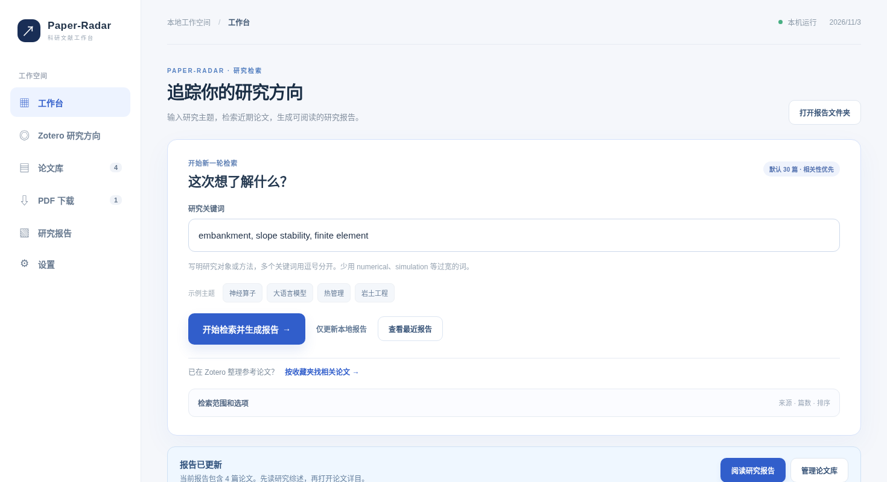
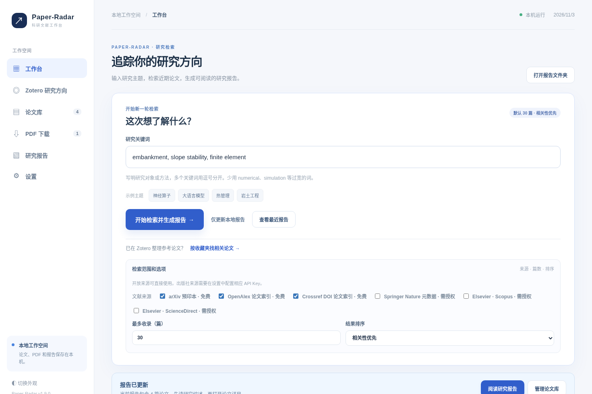
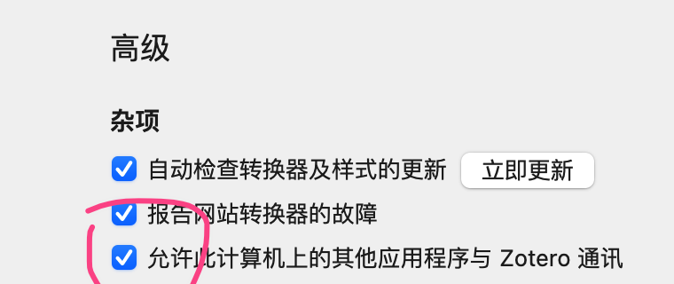
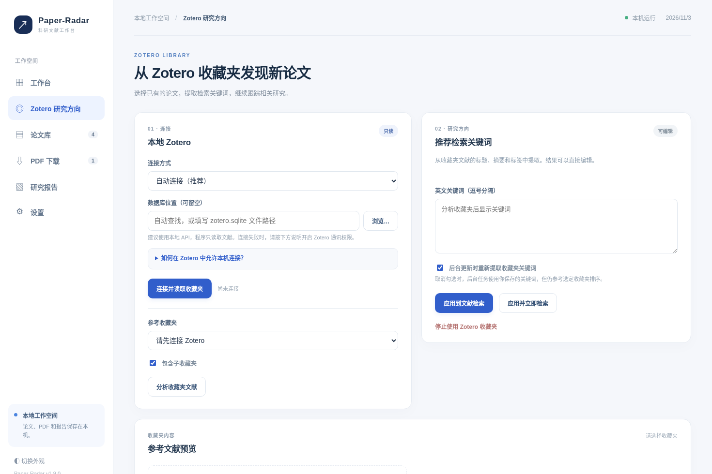
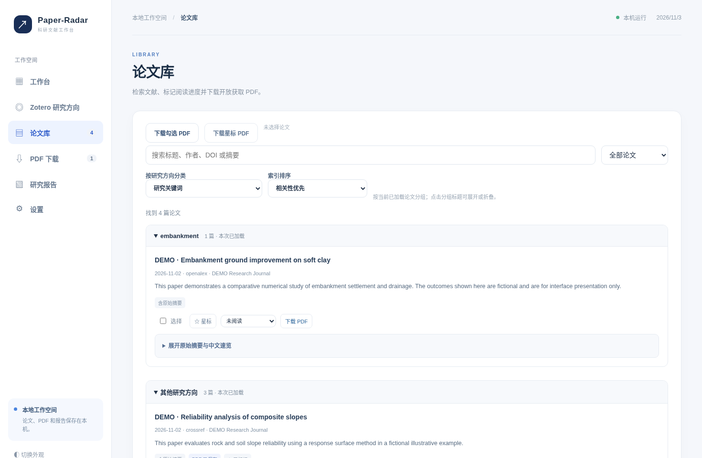
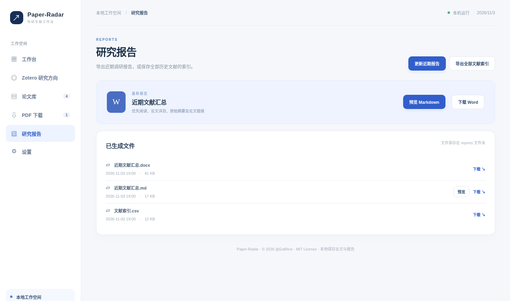
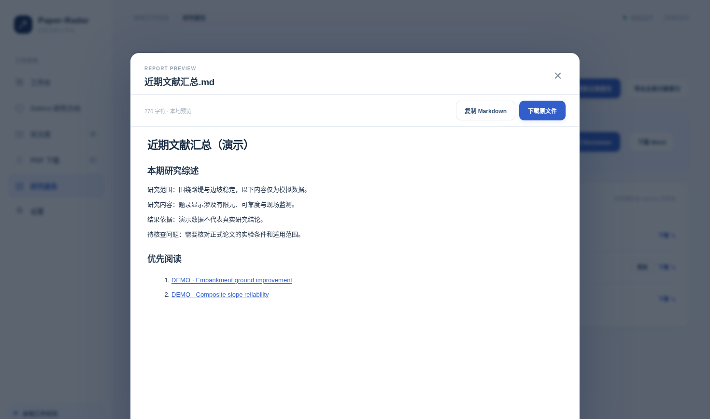
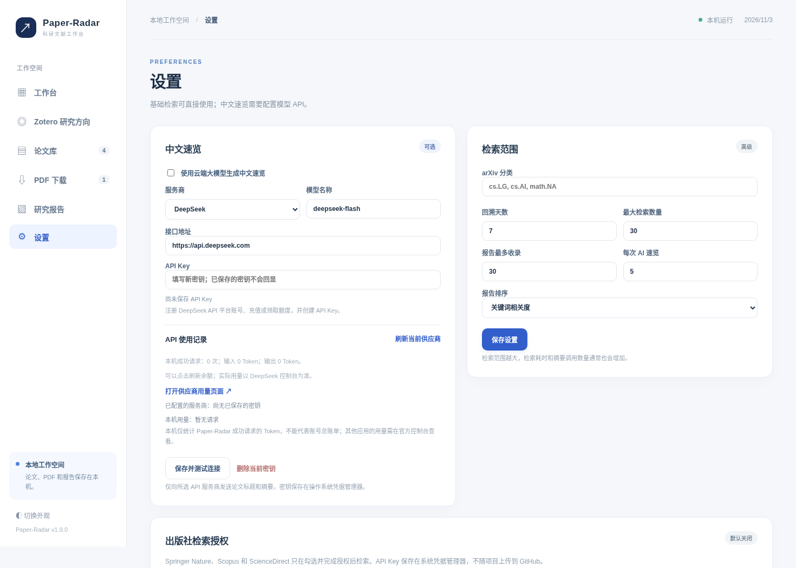

# Paper-Radar v1.12.0 完整使用手册

科研文献追踪、Zotero 研究方向、开放 PDF 下载和 Word/Markdown 报告

项目地址：https://github.com/QiQiWan/Paper-Radar　｜　© 2026 @EatRice

## 1. 使用前准备

Paper-Radar 需要 Python 3.10 以上版本和可访问学术元数据服务的网络。Windows 用户建议将程序解压至固定位置，例如 `D:\Paper-Radar`。安装 Python 时勾选 **Add Python to PATH**，然后在程序文件夹中双击 `start_windows.bat`。首次启动时会安装依赖；启动成功后浏览器打开本机工作台。macOS/Linux 可执行 `sh start_macos_linux.sh`。

程序的网页只在本机提供服务，文献库和报告默认保存在当前程序目录。第一次操作无需配置 Zotero、模型 API 或出版社账号。建议先用免费来源完成一次检索，再按需要开启其他功能。



## 1.1 运行后检查软件版本与更新

系统启动后会在后台检查 GitHub 上最新**正式发布的 Release**（默认每24小时最多检查一次）。发现更高版本会在工作台顶部显示更新提示，点击“查看官方版本”可阅读官方更新日志。进入“设置 → 软件更新检查”可关闭自动检查、调整6—168小时检查间隔，或点击“立即检查更新”。无网络或仓库尚未发布正式 Release 时，不影响文献检索。**程序不会自动安装更新**；升级前应备份原目录中的 `settings.json`、`data/`、`reports/`、`downloads/`。详见 [更新与升级指南](UPDATING.md)。

## 2. 第一次检索：输入主题并生成报告

进入左侧 **工作台**。在“研究关键词”输入英文术语，多个词组以逗号分隔。例如岩土工程可以使用 `hypoplasticity, slope stability, PLAXIS, embankment`；神经算子方向可以使用 `neural operator, operator learning, FNO`。建议用研究对象、方法或特定软件名组合，避免单独输入 `numerical`、`simulation` 等过宽的词。

点击 **开始检索并生成报告**。页面顶部出现任务进度，显示当前正在检索的来源、处理进度及运行日志。等待任务结束后，查看下方“最近一次运行”的当前主题结果数量。点击 **查看研究报告** 进入下载和预览界面；点击 **打开论文库** 查看题录。

系统默认启用 arXiv、OpenAlex、Crossref，按相关性最多收录30篇、回溯7天。实际收录量可能小于30篇。只有完整发布日期落在时间范围内、且有足够研究主题匹配依据的条目才进入本期报告。若结果为0，先扩大时间范围、核对来源状态和关键词，再考虑放宽搜索。

## 2.1 管理多个研究主题（v1.10.0）

工作台“研究主题”选择器可以切换当前课题。点击“新建主题”输入名称，当前课题的部分检索设置会复制到新主题作为初始值，但 Zotero 收藏夹关联默认清除。修改关键词、检索来源和时间范围后，先保存检索设置，再开始检索。之后切换主题时会恢复该课题的参数。主题可重命名，也可删除；默认主题不可删除。**主题共用论文库和 PDF，报告分开归档**：默认主题在 `reports/`，其他主题在 `reports/themes/<主题ID>/`。删除主题不会删除论文数据或已生成的报告文件。

Windows 每日自动任务可配置追踪当前活动主题，或依次追踪全部主题；不同主题各自设置不同时间点的计划仍未实现。已有 Zotero 收藏夹关联的课题切换后，请确认所选收藏夹名称与当前主题一致。

## 2.2 用 AI 从自然语言生成检索词（v1.9.1 起）

先进入“设置 → 中文速览”，配置模型服务商、模型名称、接口地址和 API Key，并测试连接。回到工作台展开“用 AI 规划检索词”，输入完整研究目标（至少12字），例如“关注复杂几何下神经算子的跨网格泛化、物理约束及误差比较”。点击 **生成检索词建议**，系统将研究描述发送给所选模型，并在页面显示英文检索词和检索提示。

此时系统尚未保存或执行检索。检查推荐词是否符合研究主题，可直接编辑英文短语并调整顺序。v1.10.0 的多查询模式会让更多关键词分别参与来源检索；每来源默认最多使用8组关键词（允许设定1—20组），达到上限后仍然优先使用列表前面的词。点击 **应用至研究关键词**，再单独点击 **开始检索并生成报告**。模型缺少 API Key、网络中断或返回无效 JSON 时，直接使用手工输入的英文关键词，基础检索完全可用。

如果 Zotero 已经提取过关键词，默认不会在每次检索前自动覆盖它们。确实需要让收藏夹分析覆盖手动修改时，再勾选“每次检索前重新提取关键词（会覆盖手工编辑）”。已使用旧版本且原设置为勾选的用户，应进入 Zotero 页面自行检查一次。

## 2.3 多查询如何影响检索

对于 OpenAlex、Crossref 和符合官方接口规范的出版社来源，程序按当前关键词安排多组独立查询，在每个来源内部去重，并尽量在不同关键词之间平均收录论文。arXiv 仍优先使用组合查询。每组查询成功与否都会留在来源状态中；若其中一组失败，其他成功组的结果会保留。由于查询组数增加，网络耗时和 API 配额消耗也可能增加。建议普通使用保持默认8组，遇到429限流可适当减少组数。

## 3. 怎样调整检索范围和数量

在工作台点击 **检索范围和选项** 展开高级区域，可选择来源、设定本次最多收录数量、按相关性或日期排序。日常建议保持30篇，做专题调研时再临时提高至50或80篇。超过30篇后，仍建议按阅读优先级分批处理。



更多设置位于左侧 **设置**：回溯天数、arXiv 学科代码、报告最多收录的论文数量和 AI 速览篇数。默认不限定 arXiv 学科类别；如果填入 `cs.LG` 等分类码，arXiv 检索将受到相应限制。跨学科研究初次使用建议保持分类为空。

## 4. 六种来源分别怎么用

| 来源 | 默认状态 | 需要准备 | 当前取得的内容 |
| --- | --- | --- | --- |
| arXiv | 开启 | 无 | 预印本、摘要、开放 PDF |
| OpenAlex | 开启 | 一般可直接查询，受限时申请 API Key | 题录、引用信息与开放获取地址 |
| Crossref | 开启 | 无 | DOI、出版社题录；部分条目没有摘要 |
| Springer Nature | 关闭 | 注册开发者平台并获取 API Key | 题录接口，受接口配额与权限限制 |
| Scopus | 关闭 | Elsevier API Key，视账户和机构权限 | 题录 |
| ScienceDirect | 关闭 | Elsevier API Key，且需要相应接口权限 | 题录 |

打开出版社来源前，先进入 **设置 → 出版社检索授权**，按照官方开发者平台申请 API Key 并保存。学校校园网或 VPN 有时可满足已有机构授权的 IP 条件，但不能自动开通 API，程序也不会要求输入学校账号密码。出现401、403或429时，依次核对 Key、接口资格、机构网络与速率限制。订阅论文 PDF 需到有授权的出版社网站或学校图书馆访问。

## 5. 通过 Zotero 收藏夹查找相关新论文

使用 Zotero 本地 API 时，先打开 Zotero 软件，在 **设置 → 高级 → 杂项** 勾选“**允许此计算机上的其他应用程序与 Zotero 通讯**”。Windows 通常在“编辑 → 设置”，macOS 通常在“Zotero → 设置”。保持 Zotero 运行，再打开 Paper-Radar 的 **Zotero** 页面。



在“连接方式”选择 **自动连接（推荐）**，点击 **连接并读取收藏夹**。连接成功后，选择目标收藏夹；若相关文献分散在其下级目录，勾选 **包含子收藏夹**。点击 **分析收藏夹文献**，右侧会展示依据标题、摘要和标签提炼的英文关键词，同时列出部分参考论文。



检查关键词，删除不相关词，补充 `soil constitutive model`、`inverse analysis` 等具体术语。点击 **应用到文献检索** 将其保存为当前主题，或选择 **应用并立即检索** 直接启动一次新检索。系统会尝试根据 DOI 或标题排除 Zotero 中已有的论文。背景定时任务也可选择每次重新读取收藏夹关键词。

连接失败可切换到“读取本地数据库”，选择 `zotero.sqlite`；该模式只读，不会写入或修复 Zotero 数据库。提示 403 时应先检查 Zotero 的本地通讯开关。收藏夹主要是中文文献时，自动提词可能不准确，建议手动补充英文关键词。

## 6. 论文库：如何从几十篇里找到值得读的

在左侧 **论文库**，先用顶部搜索框查找标题、作者、DOI 或摘要。再用“全部论文 / 仅看星标 / 未阅读 / 阅读中 / 已读完”筛选阅读状态。论文库按页加载，页面底部显示已加载和总命中数量；点击 **加载更多论文** 继续浏览。

“按研究方向分类”可以选择研究关键词、学科、来源、发表年份或标题首字母。每组标题可点击展开和折叠，适合先定位方向再逐篇阅读。请注意分组统计只针对当前已经加载的论文，不代表数据库中该方向的全部数量。



论文卡片默认显示短摘要，点 **完整摘要** 查看英文原文；点星标保存重点论文，阅读状态可设为“未阅读、阅读中、已读完”。含中文速览的卡片会显示 AI 标记，缺摘要的文章会明确提示需要查看原文。优先阅读列表属于筛选建议，重要数据与结果仍需查阅原始论文。

## 7. PDF 下载与失败处理

论文卡片出现 **下载 PDF** 时，说明检索源提供了可尝试访问的开放 PDF 地址。可以单篇点击，也可以勾选多篇后批量下载；**PDF 文件** 页面能够查看下载结果、失败原因及重新下载按钮。没有开放直链时，使用文章标题打开论文主页，查看出版社或图书馆可访问的全文。

默认单篇最大30MB、每次最多20篇。文献来源允许预览元数据，并不保证开放下载全文；对于需要付费订阅的论文，本软件不会绕过付费墙。自动下载默认关闭，只有需要本地归档时才建议开启。

## 8. 任务进度条与运行日志

点击主检索按钮后，工作台顶部显示当前检索阶段。可展开 **查看这次任务的运行日志**，查看检索来源、已处理数量和报错。网络等待或第三方 API 排队时无法精确预测剩余时间，进度条表示当前完成阶段；不要把百分比当作时间估算。

运行结束后进入 **设置 → 运行记录**，选择“手动任务”或“每日后台任务”查看对应记录。某一来源失败时，其他来源可能仍正常产出；全部来源均失败则会报告失败。关键检查点是：任务显示成功、论文库条目发生更新、报告文件修改时间更新。

## 9. 研究报告：先预览再下载

点击左侧 **研究报告**。页面提供 **预览 Markdown** 和 **下载 Word**；报告列表可以下载 `.md`、`.docx`、`.csv`，也可导出全部历史文献索引。Markdown 预览在本机弹窗中打开，支持复制正文。Word 可以直接编辑和归档，CSV 适合 Excel/Python 二次筛选。





报告顺序为：本期概览、主题分布、本期研究综述、优先阅读、论文详目及原始摘要。新版本会尽量把研究对象、方法名称和摘要内的结果句分开，提供可追溯的论文链接。没有摘要或缺少明确结果信息的条目不会被写成已有可靠成果；AI 中文速览也会与英文原始依据分开。

## 10. 使用 DeepSeek 提炼中文速览

无需大模型也能检索、筛选、下载和导出报告。需要中文速览时，打开 **设置 → 中文速览**，勾选启用，服务商选择 DeepSeek，在官方平台 https://platform.deepseek.com/ 创建 API Key，填入后点击 **保存并测试连接**。预置接口地址为 `https://api.deepseek.com`，模型名称以控制台当前可用的模型为准。如果返回401检查密钥，402或余额不足时检查充值与权限，429检查额度或限速。



可以选择豆包、OpenAI API、Claude、通义千问、智谱、硅基流动、Gemini 或兼容接口。页面的本机 Token 使用统计不等于服务商账户剩余额度。启用云端速览时，标题和摘要会发送给选定模型服务商；主动使用 AI 检索词规划时，研究目标描述会发送给该服务商。请勿上传未公开或受限内容。v1.9.1 会针对模型、提示词和摘要版本维护分析缓存；旧速览首次重新分析可能产生额外费用。可自动识别部分摘要未支持的明确百分比或倍数，但量化对比条件和定性结论仍需回原文核查。

## 11. Windows 每日后台更新

在工作台底部展开 **每日自动更新**，设置执行时间，点击 **开启后台更新**。系统使用 Windows 计划任务在指定时间启动独立进程，处理完成后退出；网页可以关闭。可查看运行状态、手动立即执行或停止任务。电脑需开机、联网，运行账户须有相应权限。更换项目目录、Python 解释器或 Windows 用户后应重新安装任务。

macOS/Linux 目前保留手动命令运行；尚未提供与 Windows 计划任务同等的一键后台安装。

## 12. 运行文件、升级及安全

程序本地目录中 `data/` 保存论文数据库，`reports/` 保存 Word、Markdown 和 CSV，`downloads/` 保存已下载 PDF，`logs/` 保存手动及后台记录。`settings.json` 保存非敏感用户配置；API Key 由操作系统凭据管理器处理。

升级程序前备份 `data/` 和 `settings.json`，复制新源码时保留个人数据文件。上传 GitHub 时不要包含 `data/`、`reports/`、`downloads/`、`.env`、API Key 或 Zotero 数据库；发布前检查 `git status`。许可证为 MIT，版权所有 © 2026 @EatRice。

## 13. 常见问题与具体排查

| 现象 | 优先检查的事项 |
| --- | --- |
| 论文很少或为0 | 关键词是否太窄、回溯天数是否过短、来源是否失败、是否填写了不适用的 arXiv 学科代码 |
| 论文不相关 | 删除 `numerical` 等泛化词，增加研究对象、方法名和材料边界；通过 Zotero 校对关键词 |
| Zotero 403 | Zotero 是否运行；设置 → 高级 → 杂项的允许通讯是否勾选 |
| Springer/Elsevier 返回401/403 | API Key 是否有效、接口权限是否开通、是否需要获授权的机构 IP 或机构令牌 |
| PDF 下载失败 | 是否为开放获取文件、链接是否失效、网络是否受限；查看下载失败日志并重试 |
| AI 连通性测试失败 | API Key、URL、模型名、余额、限流、国内外网络连接 |
| 明明运行成功但报告未更新 | 查看 `reports/` 修改时间，检查检索范围是否产生新论文，查看来源状态和日志 |
| 后台任务没执行 | Windows 任务计划程序、电脑休眠、Python 路径和项目位置 |
| 下载报告打不开 | 先确认 `.docx` 文件已完整生成，再用 Word/WPS 打开；`.md` 可用内置预览 |

## 14. 可直接用于 GitHub 的扩展文档

架构与插件入口参见 `docs/ARCHITECTURE.md`、`docs/ADDING_SOURCES.md`、`docs/ADDING_DOWNLOADERS.md`，出版社授权参见 `docs/SOURCES_AND_ACCESS.md`，Zotero 参见 `docs/ZOTERO_QUICKSTART.md`。

完整的正式截图需求见《Paper-Radar v1.9.0 真实截图补充清单》。


## 版本更新记录

完整逐版本改动请查阅项目根目录的 [CHANGELOG.md](../CHANGELOG.md)：v1.9.1 修复数据一致性问题并增加 AI 检索规划；v1.10.0 增加多主题、多查询及官方 Release 更新提醒。升级操作请看 [UPDATING.md](UPDATING.md)。原手册中的 v1.9 页面截图用于展示已有流程，v1.10.0 新增控件应以最新源码实际界面为准。

## v1.11.0 多主题阅读反馈与智能推荐

在工作台研究主题选择器中创建主题，保存各自的英文检索词、研究目标与 Zotero 设置。完成检索后打开“论文库”，默认查看当前主题入选论文；也可以切换“所有已收录文献”。对论文标记星标、阅读状态或“相关/不相关”只影响当前研究主题。

若开启智能推荐，进入“设置”，先检查模型提供商、模型名称和 API Key，勾选“智能推荐重排序”，设置候选数量（默认15篇），再在研究主题中填写研究目标并运行检索。模型会读取候选论文题名、摘要和研究目标，输出中文推荐理由及可以在标题或摘要中核对的原文片段。模型返回不合格、网络超时或没有可用密钥时，程序保留原关键词排序并继续执行；不会因推荐功能失败而损坏原有论文库。由于摘要并不包含所有实验细节，推荐理由只能用于决定阅读顺序。

OpenAlex 语义发现位于“检索范围和选项 → 文献来源”。默认关闭，用户需要了解该服务的额度限制。该来源依照研究目标或关键词进行语义召回，与已有关键词来源共同处理；应在真实研究主题上检查误召回。

Windows 每日任务可在工作台“自动更新 → 每日自动检索”勾选“每日依次追踪全部研究主题”，然后点击“开启后台更新”。未勾选时继续检索当前主题。也可点击“依次追踪全部主题”立即运行。批量任务每个主题独立保存报告，若部分主题失败，在状态页查看异常；设置页面底部提供最近任务历史。

**升级提示：** 从 v1.10 升级时，请备份 `settings.json`、`data/`、`reports/`、`downloads/`；第一次打开系统会自动建立 `topic_papers` 结构。以前存入的论文会保留在默认研究主题；其他旧主题需要重新运行检索以建立主题匹配关系。

## 15. v1.12.0：从 PDF 中定位原文证据

新版论文库中的已下载 PDF 卡片会显示 **全文证据**。只有通过现有下载管理器保存到 `downloads/` 的 PDF 才能进入自动解析，系统不会根据随意输入的文件路径访问电脑上的其他文件。

**第一步，建立本地索引。** 在论文库找到目标论文，确认其状态为“PDF 已保存”，点击 **全文证据 → 解析本地 PDF**。程序在当前电脑上读取文本层，按页存入 `data/papers.sqlite3`；本步骤不需要大模型密钥。状态会显示已处理页面、实际总页数、片段数，状态为 `partial` 时说明超出了页数或片段上限，不能认为已经读取了完整论文。扫描图像页缺少文本层时可能显示“未提取到文字”。

**第二步，查找需要核实的技术方法。** 在同一弹窗的“原文片段检索”中输入英文术语，例如 `geometry transfer`、`ablation`，先选择“当前论文”，再点击 **检索证据**。结果显示文本片段、PDF 页码和“打开 PDF 证据”，点击后在原始 PDF 对应页进一步阅读。切换到“当前主题的已解析论文”可在这个主题的全文索引中搜索。对于跨页表格或复杂公式，建议直接检查 PDF 页面。

**第三步，按需生成 AI 阅读卡片。** 先在设置中配置模型 API Key，再点击 **生成 AI 阅读卡片**。弹窗明确告知会将最多12个选定的正文片段发送给所选模型，可能产生 API 费用；只有确认后才会调用云端服务。卡片一般包含方法、实验与局限类别，并为每条显示页码与连续原文引文。如果模型未能提供可核验的引文，系统会提示没有有效卡片，保留原来的 PDF 索引。

**第四步，把阅读结果放进报告。** 点击 **复制证据笔记** 可得到含页码与引文的 Markdown。也可以回到“研究报告”点击重新生成：Word 和 Markdown 逐篇详情会附上对应卡片。更换本地 PDF 后旧证据会失效，请重新解析和生成卡片。没有 PDF 或没有模型 API Key 时，标题摘要级简报功能不受影响。

> 注意：论文正文解析与引文逐字匹配属于技术核验。中文解释中的研究结论、因果关系、实验可比性和数据真实性仍需要研究者对照原文检查。尤其是公式、图表、扫描 PDF 和参考文献顺序，当前解析器未作可靠结构还原。

## 16. v1.12.0：人工标注并评估推荐质量

建议先选择一个你熟悉的研究方向，收集至少50篇有代表性的论文，在真实阅读后给每篇打相关性标签。程序提供独立的命令行评估工具，不需要安装其他应用或调用云端 API。

**第一步，导出标注模板。** 在项目目录执行：

```bash
python -m paper_radar.evaluation --db data/papers.sqlite3 --export-template reports/推荐人工标注.csv --max-per-topic 50
```

该命令为每个已有关联论文的主题导出排名靠前的最多50条记录，CSV 可用 Excel 打开。保留 `topic_id`、`paper_id` 不变，只填写 `label` 列，取值为0=无关、1=弱相关、2=相关、3=高度相关。`rank`、`title`、`url` 和 `notes` 用于辅助判断。不同主题中，同一论文允许拥有不同相关性标签。模板刚导出时标签是空的，**必须先人工填写**。

**第二步，运行离线评价。** 填好 `label` 后保存 CSV，再执行：

```bash
python -m paper_radar.evaluation --db data/papers.sqlite3 --labels reports/推荐人工标注.csv --k 10 --out reports/推荐效果.json
```

输出包括当前主题的 Precision@10 保守下界、人工标注集合内的 Recall@10、NDCG@10、MRR 和 Top-10 已标注覆盖率。若覆盖率较低，应先补标签再比较不同推荐模型。由于被标注的论文可能本身来自旧排序的候选集，报告不代表整个领域的召回率；要比较 v1.11 与 v1.12 的推荐效果，应冻结相同的候选集和人工标签。
