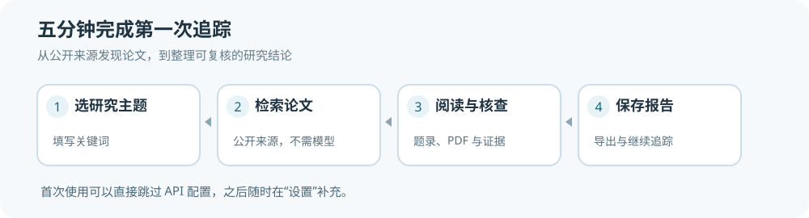
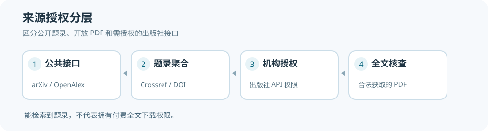
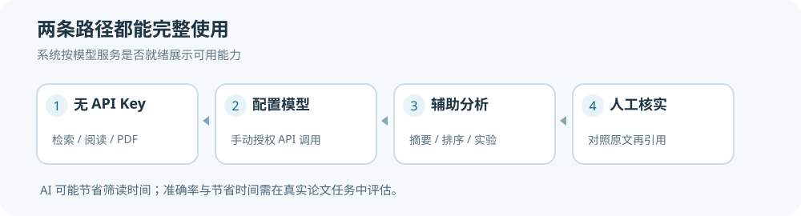
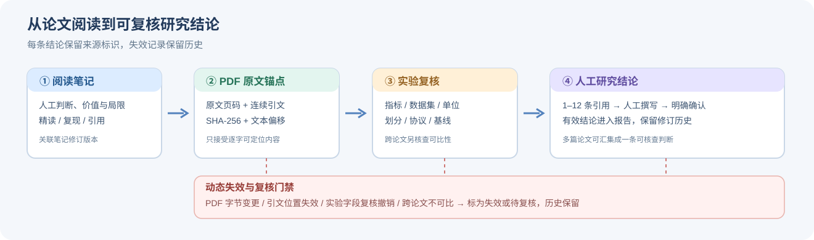

## v1.51.0：研究分析快速用法

“研究分析”仅需输入问题并点击“开始分析”。默认读取当前主题的题名和摘要，不要求先下载 PDF。结果中的论文研究方法、实验设置及作者摘要原句可供阅读选文，标记为“尚未核对全文”。

若显示大量论文摘要缺失，先点击“补全摘要”，之后重新分析；部分论文来源本身可能不提供摘要。历史记录、模型授权和 PDF 实验核验均位于折叠项，不影响正常使用。只有需要严谨对照数值时才展开“高级工具”。详见 [完整流程](ABSTRACT_FIRST_RESEARCH_V151.md)。

# v1.50.0 批量准备论文原文证据（新增）

在「研究分析」填写研究问题，点击「选择相关论文」，挑选需要准备的论文（每批最多 12 篇），然后点击「开始批量准备」。系统会逐篇检查 PDF、读取全文并提取可核对的实验片段。可随时查看任务进度，刷新页面后继续人工审核。核对每条片段的 PDF 原文、实验条件、指标和数值后，点击「核对后确认」，最终通过「查看跨论文对照」检查已确认的数据。模型辅助在明确授权后才调用；无模型时仍可继续本地原文候选处理。完整说明请查看 [批量证据工作流](EVIDENCE_PIPELINE_V150.md)。

---

## v1.49.3：研究分析和阅读卡片使用方法

在“研究分析”输入问题后，页面先显示已收录论文、主题候选、已核对结论和原文依据四个数字。出现“题录分析完成 · 实验结论待核实”表示系统已完成相关论文筛选，但尚没有足够的人工核对 PDF 原文；请通过“去阅读论文”查看原始摘要、下载并解析全文，再核实具体实验结果。题录相关性标签只表示检索优先级，不表示论文方法更优。

“论文涉及的研究方向”可帮助区分跨网格、跨几何、泛化与实验基线等检查点；“优先阅读的论文”默认展示前五篇，其余可展开。历史研究记录默认收起，避免重复问题占据页面。本地与公网文献卡片默认显示简短摘要，点击“展开完整摘要”查看全部内容；常见数学公式在网页中以本地数学排版显示。

如果需要排查 AI 是否参与，进入“设置 → 运行记录 → 研究分析阶段记录”，下载运行日志并先阅读 `README_FIRST.md`。`research_runs.json` 展示研究编号、五阶段状态、候选/引用数量以及模型状态；`MODEL_DISABLED` 表示未调用、`MODEL_USED` 表示成功完成本次模型阶段，`CANDIDATE_ONLY` 表示本次只有题录候选。日志默认不包含密钥、论文全文和研究问题正文。具体见 [诊断说明](RUNTIME_DIAGNOSTICS_V1493.md) 与 [v1.49.3 审阅](UX_AUDIT_V1493.md)。

---

<!-- GUIDE:quickstart -->
# 快速开始

第一次使用按照以下顺序操作。AI 功能在新安装时默认开启；未连接模型时，页面会显示“添加模型密钥”，普通文献检索仍可继续。普通检索不要求配置大模型 API Key。

1. **打开软件。** Windows 双击 `start_windows.bat`，等待浏览器自动打开；macOS 或 Linux 使用 `./start_macos_linux.sh`。源码版首次使用需安装 Python，启动程序会按要求安装依赖。
2. **选择研究主题。** 在**首页**按新手清单操作，选择已有主题；还没有主题时，根据提示新建一个，例如“复杂几何神经算子”。
3. **查找论文。** 点击**找论文**，输入英文关键词（建议 2—5 组，以逗号分隔），勾选至少一个开放来源（arXiv / OpenAlex / Crossref），点击**开始检索**。公网版也可以在该页直接改关键词和来源。
4. **筛选和阅读。** 在**我的文献**查看已收录论文，点击**阅读论文**进入原文区域；没有可用 PDF 时可以先查看题录和摘要、保存笔记。
5. **研究分析与报告。** 在**研究分析**用一句话输入研究问题，点击**分析研究问题**查看系统能找到的论文和依据。在**我的报告**查看、下载已有研究报告。

**v1.49.2 论文摘要、公式与研究分析：** 文献卡片缺摘要时可点击“从公开来源补取摘要”，只保存实际可获取的 arXiv/Crossref/OpenAlex 原始元数据。论文题录或摘要中的常见 TeX 公式将在页面中以 MathML 显示；复杂矩阵或自定义宏可能需要阅读原 PDF。研究分析即使尚无人工核对结论，也会展示中英文题录候选、摘要片段与建议核对的问题；这些内容不可直接作为经过验证的实验结论。检索词生成支持恢复部分非标准模型输出，网络或密钥失败仍会给出独立原因。详见 [本轮审阅报告](UX_AUDIT_V1492.md)。

**v1.49.2 运行日志概览：** 在“设置 → 运行记录”点击刷新，可查看近期模型异常、请求失败、客户端断开和慢请求次数。下载的日志包中新增 `summary.json`，可按错误编号查找对应记录。控制台 `BrokenPipeError` 多数情况下是客户端连接关闭，程序会将其与 SQLite 读写故障分开处理。详见 [运行日志说明](RUNTIME_DIAGNOSTICS_V1492.md)。

**服务器报错和日志下载（v1.49.1）：**若界面出现“模型服务暂时无法连接”，可使用普通关键词继续检索，或打开“模型连接向导”检查密钥、接口地址和网络。若出现服务器内部错误、存储异常或错误编号，点击顶部**下载运行日志**（右下角任务栏和“设置 → 运行记录”也有相同入口），将 ZIP 和 12 位错误编号一起交给维护人员。**不必等待任务结束**。默认 ZIP 不含密钥、研究正文或 PDF；如果选择附带任务日志，分享前需要人工检查其中可能包含的研究主题。页面无法访问时，在程序根目录执行 `start_windows.bat --diagnostics`；macOS/Linux 使用 `./start_macos_linux.sh --diagnostics`，日志将保存到 Downloads 文件夹。完整说明见 [运行日志与异常排查](RUNTIME_DIAGNOSTICS_V1491.md)。

**出现故障时：**本地首页如果出现“无法连接服务”，可点击“重新连接”恢复已有工作台；公网版任务状态断线后可刷新状态。已经提交的检索或报告任务请先查看任务记录，避免重复提交。右下角任务面板会说明哪些论文网站出错；一般可以先查看已找到的论文，再按提示重试。技术诊断位于“查看详情”，首次使用不需要填写请求预算或任何内部编号。

**关于模型：**本地版默认打开中文摘要、智能排序与研究辅助。没有配置密钥时，顶部会出现连接提示，点击“添加模型密钥”即可进入模型设置；普通检索、论文管理与离线分析继续可用。联网模型需要 API Key，且发送研究内容需另行授权。公网版默认选中云端实验分析，由部署管理员配置密钥；若尚未连接，用户可以按提示继续普通 PDF 解析。没有原文支持的数值不会标记为人工确认结论。

<!-- GUIDE:usage -->
# 认识工作台

| 页面 | 用来完成什么 | 首次使用建议 |
| --- | --- | --- |
| [首页](app:home) | 查看当前主题和待处理事项 | 按入门清单完成第一轮检索 |
| [找论文](app:dashboard) | 搜索新论文 | 输入关键词，选择论文网站 |
| [我的文献](app:library) | 阅读、收藏和记录论文 | 找到论文后先点击“阅读论文” |
| [研究分析](app:inquiry) | 按研究问题整理文献和证据 | 输入具体研究问题并查看引用依据 |
| [我的报告](app:reports) | 阅读和导出研究成果 | 直接打开最近生成的报告 |
| [设置](app:settings) | 主题、模型和存储等配置 | 只有出现权限或连接问题时再进入 |
| [任务记录](app:tasks) | 查看历史执行进度及失败原因 | 日常可用右下角任务面板代替 |
| [论文更新](app:following) | 查看新收录论文和待补检来源 | 需要持续追踪某方向时再使用 |
| [Zotero](app:zotero) | 导入关键词、交换引用及笔记 | 已经在使用 Zotero 时再配置 |

**界面差异：**本地版的“任务记录、论文更新、Zotero、PDF 下载”位于“更多工具”里；公网版依照账号权限提供相应功能。主要导航名称一致，具体按钮可能因权限或部署方式不同而不同。

**研究主题：**建议一个长期研究方向对应一个主题。关键词和收录论文按主题保存；公网版“找论文”修改关键词后，会先保存当前主题的新检索词和开放来源，再发起检索任务。它不会覆盖其他研究主题。

**任务面板：**任务启动后右下角浮出进度，可“最小化”，任务继续运行。任务结束后可查看来源状态和失败详情。浏览器刷新和返回不会改变已经保存的论文与研究记录。

**专业研究工具：**原文坐标、实验数据核对、跨论文数值比较、证据修订、双盲标注等仍然保留，但集中在“更多研究工具”或“原文与证据”区域。涉及论文科学结论时，自动分析结果应对照全文人工核验。

<!-- GUIDE:sources -->
# 文献来源

| 来源 | 常规检索 | 说明 |
| --- | --- | --- |
| arXiv | 公开 | 适合预印本及学术技术前沿 |
| OpenAlex | 公开元数据 | 覆盖跨学科文献与引用信息 |
| Crossref | 公开元数据 | DOI 与出版记录；部分论文没有摘要 |
| OpenReview | 公开会议投稿 | 按需开启，投稿公开不代表已录用 |
| Springer Nature | 需要相应 API Key | 按官方接口和授权查询元数据 |
| Scopus / ScienceDirect | 需要相应接口权限 | 可能涉及机构订阅或令牌 |

**首次使用可以只选择公开来源。**在「设置 → 文献来源授权」可为 OpenAlex 保存免费的 API Key，提高检索额度。小量免密访问可用，但额度受官方政策限制；OpenAlex 语义发现可能占用更多额度。Springer 和 Elsevier 等出版商接口需要单独授权。

**OpenAlex 额度检查：** 打开“设置 → 文献来源授权 → OpenAlex”，填写免费 API Key 后点“保存密钥”。需要检查额度时，再点击“检查 API 额度”（不会自动轮询）。出现 HTTP 429 时，按面板中显示的剩余额度和服务端等待时间处理：每日额度耗尽则等待下一次额度刷新；短时限流仅在剩余查询预算内允许一次退避。常规 OpenAlex 与其语义检索共享服务商用量，额度较低时建议暂时关闭语义检索。界面不展示密钥原文。

**检索数量：** 右下角任务浮动面板的“本轮检索数量明细”显示来源候选、日期过滤、跨源去重、Zotero 排除、相关性筛选、最终收录和新增论文数量。显示“成功 · 达到上限”说明本轮取得数据但仅查询了结果的一部分；研究跟进会继续将对应来源标为待补检。

**检索成功但没有 PDF：**元数据记录不保证全文开放。系统会根据论文许可和开放获取链接进行下载，付费全文需要通过学校图书馆或出版商合法渠道获取。

**连接失败：**在设置页点击**检查文献来源连接**，系统会按需测试已启用的公开接口。DNS、代理、证书、超时、限流和鉴权问题分别提示；检查不会发送研究关键词、模型密钥或 PDF。任务中心会分别显示超时、限流和鉴权失败。一个来源出错时，其他来源可以继续执行。必要时缩小检索规模或更换来源。

**检索诊断：**每次手动检索和后台检索均生成一个诊断编号。任务结束后点击右下角任务浮动面板的“查看详情”（若已最小化），再打开“检索诊断”，可以看到每个来源的查询阶段、连接时间、HTTP 状态和失败分类。点击“下载诊断包”获取 ZIP 文件；也可以从“设置 → 运行记录”下载最近一次诊断，或在“任务中心 → 历史任务”下载指定任务的诊断（最近 30 次保留）。下载的 ZIP 只有元数据，不包含检索词、文献内容、HTTP 地址、密钥或本地文件路径。Windows 默认保存在 `%LOCALAPPDATA%\Paper-Radar\logs\retrieval`，最多保留最近 30 次。

**按错误类型处理：**`SOURCE_CHILD_ENCODING` 表示子进程输出编码不兼容，升级到 v1.40.3 并重启；`SOURCE_CHILD_EMPTY` 表示子进程未返回数据；`SOURCE_CHILD_PROTOCOL` 表示结果结构或 JSON 损坏。可以在日志中查看退出码、stdout/stderr 字节数和解析阶段，不会记录原始错误内容。`DNS_ERROR` 检查 DNS 与域名解析；`PROXY_ERROR` 检查 Windows 代理及系统环境变量；`TLS_ERROR` 检查系统时间、代理证书和安全软件；`RATE_LIMIT` 缩小关键词并稍后重试；`AUTH_REQUIRED` 检查 API Key、额度与授权；`SOURCE_TIMEOUT` 查看单组预算和连接/读取阶段；`SOURCE_CHILD_START`、`SOURCE_CHILD_FAILED` 检查 Python 子进程、虚拟环境和安全软件。OpenReview 连接成功但返回 0 篇，表示请求有响应，不代表其他来源都能访问。诊断只是供排查的元数据，本软件不会自动修改 Windows 网络配置。

若要在完整检索前执行逐来源独立检查，源码版可双击根目录 `start_windows.bat --smoke`，或者执行 `python -m paper_radar.sources.smoke --live --output retrieval_smoke.json`。实际网络连接与细节参见 [v1.40.3 检索修复说明](RETRIEVAL_REPAIR_V1403.md)。

检索任务默认每组查询等待 35 秒、总预算 210 秒。升级自旧版本的默认 10/75 秒组合时会自动调整；仍可在“设置—检索”修改。Windows 下初始化来源进程也需要少量时间。公开来源可能受分页、最大结果数量和日期过滤限制。来源达到上限时，应检查任务中心的待补状态并缩小查询范围。OpenReview 使用公开的 API 2，会议投稿邀请 ID 可在本地版设置中按需填写；它不能绕过会议隐私设置。

官方开发者入口：[OpenReview](https://docs.openreview.net/getting-started/using-the-api)、[arXiv](https://info.arxiv.org/help/api/index.html)、[OpenAlex](https://docs.openalex.org/)、[Crossref](https://www.crossref.org/documentation/retrieve-metadata/rest-api/)、[Springer Nature](https://dev.springernature.com/)、[Elsevier](https://dev.elsevier.com/)。

<!-- GUIDE:model -->
# AI 模型

**模型辅助功能在新安装时默认开启，缺少密钥会主动提醒。**可用 AI 生成检索关键词、中文摘要和论文排序，并辅助提取实验候选信息。无密钥仍可使用普通检索、阅读、离线证据整理；原有用户主动关闭的选项不会在升级后重新开启。

**本地版连接步骤：**点击顶部的“添加模型密钥”，系统会直接打开三步连接向导，无需自己寻找设置页面。第一步选择模型服务商；尚无密钥时，点击对应服务商的官方密钥申请链接。第二步粘贴 API Key，密钥属于模型 API 平台，通常与官网登录密码不同；模型名称和接口地址已优先填写常见预设值，需要时才展开高级设置。第三步阅读数据发送范围并决定是否授权，然后点击“保存连接信息”。密钥保存在系统凭据管理器，页面不会回显。保存后可以直接返回工作台，只有自行点击“测试连接”并再次确认时才会发送固定测试文字并可能产生费用。需要修改已连接模型时，在“设置 → 模型服务”中打开“简易连接向导”；没有密钥时选择“暂不连接”，继续普通工作。

| 使用场景 | 可能传输的内容 | 需要注意 |
| --- | --- | --- |
| 关键词建议 | 手动输入的研究描述 | 由用户点击触发 |
| 摘要整理与智能排序 | 题名、摘要及研究目标 | 开启模型并授权后运行 |
| PDF 实验分析 | 用户选择的候选全文片段 | 执行前查看数据传输与费用提示 |

**公网版连接步骤：**普通账号看到“等待服务器配置”时，点击“查看连接方法”，阅读按角色区分的连接说明；普通研究人员联系管理员开通。管理员在服务器私有环境中配置 `PAPERRADAR_PUBLIC_LLM_KEY`、`PAPERRADAR_PUBLIC_LLM_MODEL`、`PAPERRADAR_PUBLIC_LLM_BASE` 后重启服务；不要把密钥粘贴到公开网页或提交 GitHub。公网分析选项默认开启，但论文内容在任务提交前需要明确授权。尚未连接时，用户可以选择继续不调用云模型的 PDF 解析；也可以关闭“下载与 AI 分析设置”中的 AI 选项，该选择仅针对当前账号保存。

**费用与隐私：**“默认开启”表示默认选择模型辅助功能，不代表已经同意发送论文内容。授权单独保存；PDF 实验分析每次仍会明确提示本次数据范围和预估费用。模型不可用或未授权时不会默默把分析结果标记为模型生成，也不会自行产生云端推理费用。

模型整理结果供阅读辅助。实验数值、论文归属、比较条件和研究结论仍需要复核。系统在模型不可用时可继续使用公开检索和人工笔记。

<!-- GUIDE:zotero -->
# Zotero 文献库

1. 在 [Zotero 页面](app:zotero) 中选择本地数据库或 API 连接方式。
2. 选择收藏夹，预览提取到的主题关键词。
3. 检查推荐词，确认后将它们用于研究主题。
4. 检索新论文后，仍在 Paper-Radar 论文库中记录阅读决策。

如果 Zotero 未安装或没有对应收藏夹，可跳过此步骤。直接填写关键词不会影响普通检索。

**引用导出：**论文库新增 BibTeX 与 RIS 导出，适合导入 Zotero、LaTeX 或其他文献工具。建议导出后抽查题名、作者、年份、DOI 和期刊信息，缺失字段不会自动补造。

**阅读笔记回写（本地版）：**使用 Zotero Web API 写入前，在系统环境设置 `ZOTERO_USER_ID`（数字账户 ID）和 `ZOTERO_API_KEY`（需有写入权限）。重启 Paper-Radar 后，先在论文库保存个人笔记，再进入 Zotero 页面预览将写入的 DOI 对应条目、版本号和笔记内容，明确确认才创建子笔记。原 Zotero 题录与 PDF 附件不做修改。出现 409/412 等冲突时，先在 Zotero 检查并重新预览，避免重复写入。

**从 Zotero 回读：**在 Zotero 页面从论文列表中选择相应的论文，选择“预览从 Zotero 读取”。只有该 DOI 对应的 Zotero 条目包含唯一一条由 Paper-Radar 创建的子笔记时，才允许确认导入。确认时会重新读取 Zotero 笔记并比对指纹，随后通过本地笔记版本检查追加内容；已存在的相同内容不会重复写入。原有本地笔记会保留，超过长度上限时拒绝合并。

当前实现 DOI 唯一匹配、子笔记人工写入与安全回读。自动全量双向同步、标签冲突合并及跨设备后台同步仍待后续迭代。

<!-- GUIDE:inquiry -->
# 研究分析：从论文原文整理研究进展

研究助手会使用当前研究主题中已收录的论文和人工确认的 PDF 证据，形成可追溯的研究简报。未读的论文只列入候选清单，不会被写成已经验证的结论。

1. 先在[找论文](app:dashboard)选择至少一个公开来源，执行检索。遇到失败时，在任务中心查看具体错误；也可在设置页点击**检查文献来源连接**。
2. 在[我的文献](app:library)精读相关论文，保存 PDF 原文锚点，核查实验条件并人工确认研究结论。
3. 打开[研究分析](app:inquiry)，输入研究问题，点击**分析研究问题**；需要更深入的跨论文比较时，再展开“更多研究工具”。
4. 阅读**已确认结论、相关论文、实验差异和仍需核实的问题**；点击引用跳转到 PDF 原文。
5. 下载 Markdown 后可继续核对；已保存的报告会在打开时重新验证原文指纹、证据版本和人工确认状态。

**模型权限：**模型辅助入口默认勾选，缺少密钥或授权时自动采用离线证据整理。模型已连接时，提交该项研究分析仍需确认本次传输范围；仅发送研究问题及部分已确认结论文字，模型只能调整已有结论的排列顺序。即使没有 API Key，仍能生成证据简报。

**检索不完整：**某个来源超时、限流、返回数量触顶或版本检查失败时，简报会显示“待补检”提示。此时不能将已收集的论文视为领域全量研究。转到[研究跟进](app:following)检查失败来源。

**引文效力：**原文定位成功可以证明引用位置，不能独立证明实验正确或论文间指标可比；这两项仍须人工审核。多篇论文出现不同实验数值时仅提示核查，不直接给出方法优劣结论。

## 每天自动跟踪（v1.49）

在“找论文”页面下方点击“设置每天自动检索”，或从“设置 → 自动跟踪”打开独立向导。第一步选择仅跟踪当前主题还是所有主题，第二步选择每天运行的时间，第三步确认启用。**内置自动计划任务目前仅支持 Windows**；macOS/Linux 的用户会看到系统限制，需要另行配置 cron/launchd，不应把保存时间当成后台任务已启用。单来源查询预算、超时和结果上限都位于“设置 → 检索”，日常查论文无须调整。

## 在 PDF 内阅读和提问（v1.49）

打开“我的文献”，选择论文并点击“阅读论文”。如果已经保存 PDF，先点击“读取 PDF 全文”；在阅读页面中直接选择“阅读摘要”“实验结果”或“向论文提问”。实验结果属于待核对的候选材料，跨论文比较需检查数据集、指标、实验条件是否一致。

“向论文提问”可以使用中文；系统会对有限的一组科研词汇（如基线、实验、几何、网格）匹配常见英文术语，从当前 PDF 已索引文字中查找原文。回答会展示原文摘录和 PDF 页码，可以直接跳转核对。没有相关文字时会明确告知，没有 PDF 或尚未解析时会提示先读取全文。这个离线功能不能保证覆盖复杂中文问法，也不提供无证据的研究结论。

若连接模型且已授权数据发送，可自行勾选“使用 AI”，此时系统还会再次询问是否同意本次发送研究问题及最多六段原文。模型返回的文字必须包含有效的引用编号；出现缺失来源或新增未经原文支持的数字时，界面仅保留原文摘录。**引用号、页码与原文相符不等于科研结论自动通过人工验证。**公网工作台目前对单篇论文问答提供无需云模型的原文定位。

<!-- GUIDE:reading -->
# 阅读笔记、PDF 和研究证据

## {#library} 论文筛选与阅读决策

论文入库后可标星、跳过、标记已读，并批量处理常见操作。需要继续研究的论文可指定精读、复现、引用或讨论，并填写人工笔记。

## {#pdf} PDF 原文定位

**PDF 原文锚点：**阅读时选中论文原文中的片段，保存页码、逐字引文及 PDF 文件指纹。创建锚点时的阅读笔记会保存独立快照，之后修改笔记不会改变原有证据记录。

**精确高亮：**在本地版或公网版阅读区选择当前 PDF 页码，粘贴 6—700 字的逐字引文，点击“定位原文”。程序会验证原 PDF 的 SHA-256，并根据文字层返回坐标及图像高亮；匹配不到会要求人工核查，不会编造坐标。此功能需要额外安装 PyMuPDF：`python -m pip install "pymupdf>=1.24,<2"`。扫描版 PDF 不能保证文字层可检索。

**表格候选：**“查看本页表格”可展示页面中的结构化单元格候选。表格提取不具有科学真实性保证；合并单元格、公式、上下标、图片表格和缺少单位的内容都需要对照 PDF 核查。

**实验数据：**从 PDF 提取的实验指标和数值先作为候选记录；检查单位、测试对象、数据集、对照组和评价口径后再完成复核。跨论文数值比较需要额外确认可比条件。

## {#reports} 研究结论与报告

可以引用多篇论文的证据撰写结论，再由研究者确认。PDF 更换、实验复核变化或证据失效时，结论会显示待复核状态。导出的有效结论只包含当前通过验证的引用。

| 研究记录 | 保存的信息 | 复核重点 |
| --- | --- | --- |
| 阅读笔记 | 人工判断、下一步行动 | 是否仍适用于当前阅读结论 |
| PDF 证据 | 原文引文、页码、文件指纹 | PDF 是否更新、引文是否仍可定位 |
| 实验记录 | 数据集、指标、单位、对照 | 数值是否正确、不同论文是否可比 |
| 研究结论 | 支持证据、修订与确认状态 | 引用是否有效、结论是否经过人工核对 |

**报告阅读：**公网版生成报告时，先列出当前主题收录的论文题录（最多展示 30 篇），供筛选和阅读；随后列出已核对的实验依据与比较。题录数量与有证据的论文数量分别统计。如果只完成了检索、尚未验证 PDF 原文，报告仍能展示文献清单，但实验比较会说明“暂无可核对证据”。报告页可预览 Markdown，下载可用格式，历史笔记和原文引用可分别追踪。与公开论文不一致的模型生成内容应修订后再用于正式研究材料。

<!-- GUIDE:following -->
# 持续跟进

**首次检索：**在“找论文”中选择主题和开放来源，运行一次检索。完成后进入[研究跟进](app:following)，查看来源上次成功时间、新收录论文及待处理提醒。

**每天跟进：**可在设置中配置每日检索任务。系统按主题、来源保存上次成功检查点，并根据关键词和查询范围生成查询指纹。只在成功获取、未使用旧缓存且未触发结果上限时，才更新该来源的完成状态。

**中断补检：**断网、来源限流或结果达到上限时，来源显示“待补检”；恢复网络后再次运行即可尝试覆盖未完成的时间窗口。对于大量结果截断、接口不允许历史查询或超出授权范围的情况，仍可能需要缩小关键词或人工补检。不要把“任务完成”直接当作“无遗漏”。

**论文版本变化：**对已收录 arXiv 论文执行限量 ID 查询，以发现旧论文的新版本；Crossref 检查索引日期内更新的 DOI 元数据。正式发表和撤稿仅作为待核实线索，需要阅读官方记录。

**通知：**本地与公网工作区均可配置站内提醒及已读状态。邮件摘要仅本地版提供，默认关闭，需填写邮箱并配置 SMTP 环境变量后才会发送公开题录标题。邮件中不会附带 PDF、模型密钥或原文批注。

**备份：**本地版可在“设置 → 数据与备份”中创建数据库备份或包含 PDF 的完整备份。自动备份默认保存最近 7 份元数据快照，不清理手动创建的完整备份。恢复前先退出程序，在空目录执行 `python -m tools.backup restore <备份目录> --to <全新目录>`，再校验论文数、设置及 PDF 文件；软件不覆盖已有用户数据。

**日常检查：**建议每周查看一次“待补检”来源，并把数据库与 PDF 完整备份复制到另一块磁盘或受信任的备份位置。只有本机同盘自动备份时，不应将它视作硬件故障的异地恢复副本。

<!-- GUIDE:desktop -->
# 本地运行和数据位置

**启动：**Windows 双击 `start_windows.bat`；macOS/Linux 执行 `./start_macos_linux.sh`。首次启动安装依赖；正常启动后自动打开浏览器。

**停止：**前台模式按 `Ctrl+C`。避免重复启动同一工作台；已经运行时，程序会优先打开现有服务。

**数据保存：**Windows 新安装使用 `%LOCALAPPDATA%\Paper-Radar`，macOS 使用 `~/Library/Application Support/Paper-Radar`。Linux 源码运行默认为项目目录，也可通过 `PAPER_RADAR_USER_HOME` 指定绝对路径。论文、笔记和配置存放在数据目录；程序文件可单独更新。

**更新：**在设置页查看正式版本更新。只有通过签名与摘要验证的发布包才会安装；自动安装默认关闭。更新时需等研究任务结束。

**状态异常：**在设置的“存储与数据”中检查数据库路径及连接状态；检查磁盘空间和目录权限。遇到磁盘读写错误时先停止重复进程，不要手动修改正在使用的 SQLite 数据库。

<!-- GUIDE:portal -->
# 公网多人工作台

公网版支持个人账号、研究主题、论文检索、任务管理、全文阅读和证据核对。进入“找论文”后可以直接修改关键词和开放来源，再提交检索；普通用户无需先在设置里修改主题。不同账号的论文、笔记和实验判断分别保存。普通用户按照管理员开放的权限使用文献来源与模型服务。

公网服务需要由管理员另行部署 Web 与 Worker、数据库和反向代理。个人 Windows 用户使用本地版即可，无需配置公网账号或服务器。

## v1.44–v1.45 科研综合分析与研究跟进

在“研究分析 → 更多研究工具”中提供三个页签：**综合分析**、**研究记忆**、**周期简报**。综合分析要求输入具体研究问题，使用当前课题已人工确认的 PDF 结论进行研究综合，并展示可追溯页码。系统可同时提供待人工复核的全文候选，不将其列为确认结论。模型辅助仅在本地版明确勾选模型和本次传输许可后执行。

研究记忆包含笔记、问题、假设和人工确认结论。确认型记忆需要原文结论 ID 和一致文本。研究简报可选择日、周、月；勾选并保存后，只有成功运行检索任务才会触发对应上一个完整周期的自动简报。任何简报的增量事件都是题录级信号，读者仍需阅读全文及研究判断。

参见 [科研综合分析实现与限制](RESEARCH_SYNTHESIS_V1.44.0.md) 及 [持续研究记忆与周期简报](RESEARCH_CONTINUITY_V1.45.0.md)。升级前应备份数据库及 PDF，旧版本无法识别新增数据库迁移版本。
