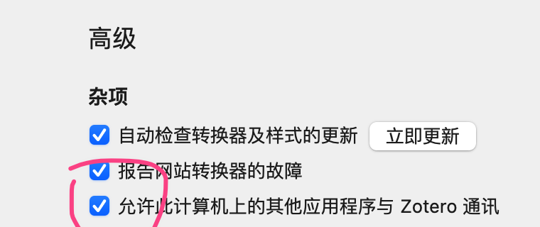
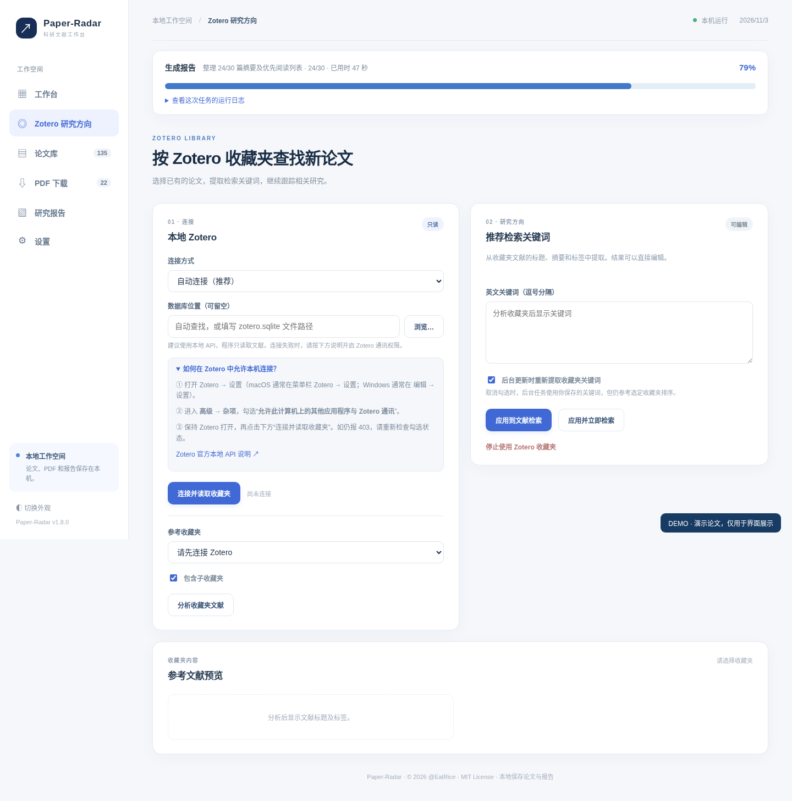

# Zotero 本地连接：图文步骤

## 打开 Zotero 的本机通讯

1. 打开 Zotero 桌面软件。
2. 打开 **设置 → 高级 → 杂项**。
3. 勾选 **允许此计算机上的其他应用程序与 Zotero 通讯**。
4. 关闭设置窗口，保持 Zotero 正在运行。

勾选后本地 API 地址通常为 `http://localhost:23119/api/`。此地址只能由本机访问，若返回 403，多数情况下需要检查上述开关。**不要打开 Zotero Web API 的公开共享或把本地端口暴露到公网。**

## 连接 Paper-Radar

1. 打开左侧 **Zotero 研究方向**。
2. 连接方式选择“自动连接”，点击 **连接并读取收藏夹**。
3. 选择一个研究收藏夹，决定是否包含子收藏夹。
4. 点击 **分析收藏夹文献**，检查系统提炼的关键词。
5. 修改不合适的关键词，点击 **应用并立即检索**。

## 只读数据库方式

Zotero 没有运行时，可以选择“只读数据库”，定位 Zotero 设置里显示的数据存储位置或直接定位 `zotero.sqlite`。程序采用只读连接，不能修改你的文献、标签和附件。数据库文件可能随 Zotero 版本变化，遇到兼容问题可以改用官方本地 API 方式。

## 关键词准确性

关键词基于已选收藏夹的题名、英文摘要和标签生成；若收藏夹内存在大量中文题录，建议补充英文关键词。推荐列表基于文本相关性进行排序，无法代替对论文方法、实验和贡献的人工判断。系统会尽量识别已收藏论文，减少重复推荐。

Zotero 本地 API 参考：https://www.zotero.org/support/dev/web_api/v3/start
